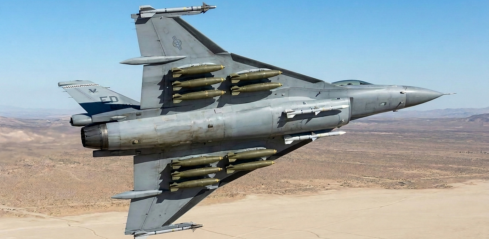

# General Dynamics F-16E Freedom Falcon

| | |
|:---------- |:------- |
| The **General Dynamics F-16E Freedom Falcon** (two-seat variant designated **F-16F**) is an American single-engine, supersonic, long-range multirole strike fighter and maritime interdictor developed by [General Dynamics](https://en.wikipedia.org/wiki/General_Dynamics) at its Fort Worth Division. Derived from the experimental cranked-arrow delta-wing [F-16XL](https://en.wikipedia.org/wiki/General_Dynamics_F-16XL), the aircraft was redesigned for volume export production by integrating NASA-developed hinged Leading-Edge Vortex Flaps (LEVFs), a high-thrust [General Electric F110](https://en.wikipedia.org/wiki/General_Electric_F110) turbofan engine, and an expanded internal fuel capacity of 12,350 pounds (5,602 kg). Featuring 29 external weapon stations and an unrefueled combat radius exceeding 700 nautical miles (1,300 km), the F-16E delivered deep-interdiction capabilities comparable to heavy twin-engine fighters at a fraction of their procurement and operating costs.  The aircraft's development was catalyzed by the Department of Defense's landmark regulatory reform, [Directive 5105.38-M](https://github.com/BJSmithIEEE/AltHist/blob/main/aircraft/DSAA_Directive_5105.38-M.md). Promulgated in October 1976, the directive established a strict Two-Tier export stratification and mandated full research and development cost recoupment on foreign military sales. This policy prohibited the Pentagon from subsidizing baseline F-16A exports, pricing the standard Falcon out of low-budget allied air forces, which turned to the dedicated Tier-2 [Northrop F-19 Tigershark](https://github.com/BJSmithIEEE/AltHist/blob/main/aircraft/Northrop_F-19_Tigershark.md). Blocked from monopolizing the low-end export sector and having lost the domestic Enhanced Tactical Fighter (ETF) fly-off to the twin-engine [McDonnell Douglas F-15E Strike Eagle](https://en.wikipedia.org/wiki/McDonnell_Douglas_F-15E_Strike_Eagle) in early 1984, General Dynamics launched an aggressive upmarket counter-strategy designated **Project 401X**.  Unlike the F-19, which followed a commercial export model with mandatory domestic adversary adoption, the Freedom Falcon operated on a **domestic-and-export commonality model**. General Dynamics partnered with the [United States Air Force](https://en.wikipedia.org/wiki/United_States_Air_Force) to standardize the F-16E and F-16F Mission Design Series (MDS) designations. The USAF established a permanent evaluation cadre at [Edwards Air Force Base](https://en.wikipedia.org/wiki/Edwards_Air_Force_Base) comprising four production-representative airframes and two refurbished F-16XL prototypes. In exchange, the Air Force mandated over 70 percent commonality in forward fuselage structure, subsystems, and radar components with its frontline F-16C/D Block 30/40 inventory, alongside complete engine interchangeability with the USAF's high-rate F110-GE-100/129 supply chain. This zero-budget-hit partnership lowered component overhead for the Air Force while providing foreign customers with an official DoD logistics pipeline and airworthiness certification.  A total of **382 airframes** were manufactured between 1985 and 1996 across assembly facilities in Fort Worth, Texas, and licensed co-production plants at [Mitsubishi Heavy Industries](https://en.wikipedia.org/wiki/Mitsubishi_Heavy_Industries) in Komaki, Japan. The F-16E/F served as the strategic strike backbone for premier Tier-1 allies facing severe geographical or geopolitical constraints, including the Israeli Air Force (where two-seat F-16Fs replaced the cancelled [IAI Lavi](https://en.wikipedia.org/wiki/IAI_Lavi)), the Royal Saudi Air Force (which procured the aircraft after the U.S. Congress embargoed the F-15E), the Japan Air Self-Defense Force (as the F-16EJ maritime interdictor under the FS-X program), the Turkish Air Force, and the Republic of Singapore Air Force. The fleet saw extensive combat during the 1991 Gulf War, Israeli regional long-range deterrence operations, and Middle Eastern precision-strike campaigns. Production concluded in 1996 as the post–Cold War defense consolidation pivoted resources toward the emerging Joint Strike Fighter program. | **General Dynamics F-16E Freedom Falcon**     *LEVF enabled, test USAF F-16E Freedom Falcon armed with two AIM-120 AMRAAMs on chin intake hardpoints (normally used for pods) and ten Mk 83 (1,000 lbs) bombs during low-level interdiction trials over the Mojave Desert (1986)*    **Role**: Multirole strike fighter / deep interdictor **National origin**: United States **Manufacturer**:  • [General Dynamics](https://en.wikipedia.org/wiki/General_Dynamics)  • [Mitsubishi Heavy Industries](https://en.wikipedia.org/wiki/Mitsubishi_Heavy_Industries) (F-16EJ)   **Status**: In service   **Primary operators**:  • [Israeli Air Force](https://en.wikipedia.org/wiki/Israeli_Air_Force) • [Japan Air Self-Defense Force](https://en.wikipedia.org/wiki/Japan_Air_Self-Defense_Force)  • [Turkish Air Force](https://en.wikipedia.org/wiki/Turkish_Air_Force)  • [Royal Saudi Air Force](https://en.wikipedia.org/wiki/Royal_Saudi_Air_Force) (former) • [Republic of Singapore Air Force](https://en.wikipedia.org/wiki/Republic_of_Singapore_Air_Force) (former)    **Number built**: 388 • (2) F-16XL prototypes • (4) USAF test airframes • (382) F-16E/F exports **Produced**: 1985–1996  **First flight**:  • *F-16XL:* July 3, 1982 • *F-16E:* March 14, 1985 **Introduction**: • TAC (USAF): October 1986 • Heyl Ha'Avir (IAF): June 1987   **Unit cost**: US$23.5-25.0M flyaway cost (1985)  **Developed from** • [General Dynamics F-16 Fighting Falcon](https://en.wikipedia.org/wiki/General_Dynamics_F-16_Fighting_Falcon) • [General Dynamics F-16XL](https://en.wikipedia.org/wiki/General_Dynamics_F-16XL)  **Variants**: F-16EJ (Japanese maritime strike variant) |

## 1976 DSAA Directive 5105.38-M

*Main article: [DSAA Directive 5105.38-M](https://github.com/BJSmithIEEE/AltHist/blob/main/aircraft/DSAA_Directive_5105.38-M.md)*

The development and commercial survival of the F-16E Freedom Falcon were direct consequences of the regulatory overhaul enacted by the Department of Defense in late 1976. Under the terms of [Directive 5105.38-M](https://github.com/BJSmithIEEE/AltHist/blob/main/aircraft/DSAA_Directive_5105.38-M.md), the Pentagon outlawed the discretionary waiver of Non-Recurring Cost (NRC) research-and-development recoupment fees on foreign military sales. Previously, the [United States Air Force](https://en.wikipedia.org/wiki/United_States_Air_Force) had routinely waived these fees to discount the baseline [F-16A Fighting Falcon](https://en.wikipedia.org/wiki/General_Dynamics_F-16_Fighting_Falcon) on the international market, driving down domestic unit costs for its own inventory. 

When the 1976 directive mandated an audited pro-rata R&D surcharge of $1.8 million to $2.4 million per airframe and instituted strict 20-year lifecycle operating cost audits, the economic landscape shifted dramatically:

1. **The Low-Tier Squeeze:** Developing allies and traditional [Northrop F-5](https://en.wikipedia.org/wiki/Northrop_F-5) operators were disqualified by DSAA audits from purchasing the high-maintenance, fly-by-wire F-16A. These nations were routed toward the dedicated Tier-2 [Northrop F-19 Tigershark](https://github.com/BJSmithIEEE/AltHist/blob/main/aircraft/Northrop_F-19_Tigershark.md), depriving General Dynamics of hundreds of anticipated entry-level export sales.
2. **The Flank Squeeze:** Wealthier, high-budget Tier-1 maritime nations requiring twin-engine overwater safety—principally Canada, Australia, and Spain—selected the [McDonnell Douglas F/A-18 Hornet](https://en.wikipedia.org/wiki/McDonnell_Douglas_F/A-18_Hornet) following the private 1976 "Hawthorne–St. Louis Truce."
3. **The High-End Strike Vise:** Premium air forces demanding long-range interdiction looked toward the twin-engine [McDonnell Douglas F-15 Eagle](https://en.wikipedia.org/wiki/McDonnell_Douglas_F-15_Eagle). However, Washington frequently embargoed the F-15E from Middle Eastern allies over regional escalation concerns, leaving a massive, unaddressed capability gap between lightweight point-defense fighters and unobtainable heavy twin-engine interdictors.

Recognizing that the standard F-16C/D was trapped in a shrinking middle market, General Dynamics launched an aggressive corporate counter-offensive to escape the regulatory squeeze by moving decisively upmarket into deep interdiction.

## Design and development

### Origins and Project 401X
In 1980, General Dynamics initiated construction of two [F-16XL](https://en.wikipedia.org/wiki/General_Dynamics_F-16XL) cranked-arrow delta-wing prototypes to compete in the U.S. Air Force's Enhanced Tactical Fighter (ETF / Dual-Role Fighter) competition. While the F-16XL demonstrated extraordinary payload capacity and internal fuel volume during flight trials at [Edwards Air Force Base](https://en.wikipedia.org/wiki/Edwards_Air_Force_Base), corporate leadership at Fort Worth recognized early that Tactical Air Command had an insurmountable institutional preference for the rival [McDonnell Douglas F-15E Strike Eagle](https://en.wikipedia.org/wiki/McDonnell_Douglas_F-15E_Strike_Eagle). The F-15E was a twin-engine design requiring minimal wing structural re-tooling compared to the radical new cranked-arrow airframe.

Rather than waiting for the formal award to terminate the program, General Dynamics executives quietly initiated **Project 401X** in late 1982. The project sought to re-engineer the cranked-arrow configuration into an export-optimized, high-payload deep interdictor tailored for premier Tier-1 allies facing severe geographical or geopolitical constraints. 

### The Tripartite Aerospace Protocol (November 1983)
To ensure the aircraft could be produced at a viable flyaway cost without relying on massive domestic USAF production runs, General Dynamics convened a classified trilateral defense-industrial summit in November 1983 with leadership from [Mitsubishi Heavy Industries](https://en.wikipedia.org/wiki/Mitsubishi_Heavy_Industries) (MHI) and [Israel Aerospace Industries](https://en.wikipedia.org/wiki/Israel_Aerospace_Industries) (IAI), alongside Elbit Systems:

* **Japan's Aerostructures Partnership:** Japan sought a long-range maritime strike fighter to replace the Mitsubishi F-1 under its FS-X program. Tokyo required an unrefueled combat radius exceeding 700 nautical miles to patrol the Sea of Japan and East China Sea carrying four indigenous anti-ship missiles, bypassing Diet constitutional prohibitions against in-flight refueling tankers. Under the 1983 U.S.–Japan Defense Technology Sharing Agreement, MHI joined Project 401X as a tier-1 aerostructures partner. Leveraging its world-leading commercial autoclave infrastructure, MHI agreed to manufacture the co-cured carbon-composite cranked-arrow wing panels not only for Japan's single-seat **F-16EJ**, but as a primary component supplier feeding the Fort Worth final assembly line for all worldwide exports—directly mirroring Japan's high-rate commercial aerostructures contracts with Boeing.
* **Israel's Two-Seat Specialization and the Lavi Redirection:** The Israeli Air Force (Heyl Ha'Avir) stated unequivocally that it required exclusively the two-seat **F-16F** configuration, utilizing a dedicated rear-seat Weapon Systems Officer (WSO) for deep-strike mission management. Facing severe DSAA audit scrutiny and ballooning research costs on its indigenous [IAI Lavi](https://en.wikipedia.org/wiki/IAI_Lavi) project, the Israeli Ministry of Defense agreed to halt prototype fabrication of the Lavi for its FY1984 budget. Instead, Israeli defense funds and U.S. FMS aid were redirected into F-16F development. In FY1985, IAI and Elbit tooled specialized manufacturing lines in Lod to fabricate the F-16F’s full-length dorsal avionics spines, conformal fairings, and cockpit integration suites. Because Israel’s top aerospace engineers were immediately integrated into the high-priority F-16F program, the feared engineering brain drain to East Asia was completely prevented; lacking foreign technical assistance, the People's Republic of China was forced to abandon the Chengdu J-10 program.

### USAF Standardization and the Launch MOUs (May 1984)
When Tactical Air Command formally selected the F-15E for the ETF requirement in February 1984, General Dynamics immediately presented the pre-packaged Project 401X export consortium to the Pentagon. Backed by signed Memoranda of Understanding (MOUs) secured in May 1984—with Israel committing to 72 F-16Fs and Japan providing a bilateral FS-X commitment for 110 F-16EJs—General Dynamics satisfied the Air Force's prerequisite for bankable foreign launch partners.

The Air Force had already reserved the F-16E/F during the ETF competition, should the F-16XL be selected. Despite its loss, in May 1984, the Air Force formally standardized the Mission-Design-Series designations **F-16E** (single-seat) and **F-16F** (two-seat) for the export-only variant. Because the redesigned strike fighter utilized over 70 percent structural, avionic, and sub-system commonality with the frontline F-16C/D Block 30/40 inventory—and relied on the same [General Electric F110](https://en.wikipedia.org/wiki/General_Electric_F110) engine core—every international sale drove down spare-parts overhead for active USAF wings. In exchange, the Air Force established a dedicated four-aircraft USAF evaluation flight at Edwards AFB to handle weapons certifications, flight-control schedule validation, and foreign customer conversion.

### Inherent Stability, Aerodynamic Damping, and Low-Level Ride Qualities
A distinct yet quietly marketed advantage of the F-16XL planform—and the subsequent production F-16E/F—was its inherent aerodynamic stability relative to the baseline Falcon. 

The standard F-16A/B and, subsequent, F-16C/D utilized relaxed static longitudinal stability (RSS) to achieve radical instantaneous turn rates, relying on its quad-redundant flight control computer to prevent violent, divergent pitch-up. In early export service, this extreme design led to notable pilot anxiety regarding deep-stall susceptibility and sudden out-of-control departures during system anomalies, giving rise to the derogatory pilot nickname "lawn dart." To maintain directional stability at high angles of attack, baseline F-16s required twin under-fuselage ventral strakes.

In contrast, the F-16E/F's massive 663 sq ft (61.6 m²) cranked-arrow delta and lengthened fuselage produced substantial natural aerodynamic damping:

* **Elimination of Ventral Fins:** The expansive wing area and strong vortex lift generated by the 70-degree inboard leading edges stabilized the airflow across the vertical empennage at extreme angles of attack, allowing General Dynamics to completely delete the twin ventral fins without sacrificing directional control.
* **Benign Departure Characteristics:** If the digital fly-by-wire (DFBW) computers suffered sensor degradation or partial channel failure, the cranked-arrow platform did not violently pitch over on its back. Instead, it exhibited a gentle, controllable mushing descent, making the aircraft significantly more forgiving for junior or transitioning pilots.
* **The Low-Level Ride Trade-Off:** The primary aerodynamic trade-off was wing loading and gust response. The enormous wing area caught atmospheric turbulence at low altitude, resulting in a noticeably bumpier, higher-vibration ride during low-level overland penetration compared to the narrow-chord wings of the Panavia Tornado or F-111. 

General Dynamics Fort Worth sales teams had to navigate a delicate marketing balance: they could not explicitly promote the Freedom Falcon’s superior natural stability without inadvertently validating foreign air force fears regarding the flight safety of the standard F-16A Block 15 or forthcoming F-16C/D Block 30/40 lines they were simultaneously selling. 

Nevertheless, this benign handling proved a decisive selling point during confidential foreign evaluations:

* **Maritime Patrol and High-Altitude Loiter:** For maritime operators like the **JASDF (F-16EJ)** and the **RSAF (Singapore)**, low-level terrain-following bumpiness was irrelevant. Their primary operational profiles called for medium- to high-altitude maritime transit, extended loiter over ocean choke points, and stand-off missile releases where the aircraft's stable, stable platform provided smooth autopilot tracking and reduced pilot fatigue over multi-hour oceanic sorties.
* **Tactical Exceptions (Israel):** The **Israeli Air Force (Heyl Ha'Avir)** was the notable exception, deliberately accepting the stiffer, high-vibration low-level ride quality in exchange for the F-16F’s unmatched unrefueled penetration radius and the second-seat Weapon Systems Officer (WSO) station to manage low-altitude terrain avoidance and precision stand-off munitions.

### Aerodynamic evolution and Leading-Edge Vortex Flaps (LEVFs)
The aerodynamic foundation of the F-16E was its expansive 663-square-foot (61.6 m²) carbon-composite cranked-arrow delta wing, featuring an inner 70° sweep angle transitioning to 50° along the outer panels. While the original F-16XL prototypes achieved remarkable aerodynamic stability with supersonic wave-drag efficiency and internal fuel fraction, flight testing revealed two critical aerodynamic penalties:

* High rotation angles during heavy-ordnance takeoffs, requiring a takeoff ground roll of approximately 2,450 feet (747 m) that compromised tail-strike margins when carrying large centerline stores.
* Elevated induced drag at high angles of attack, which increased landing approach speeds to 145–150 knots and bled energy during sustained transonic turns.

To eliminate these deficiencies without introducing radar-reflective forward canards, General Dynamics collaborated with the NASA Langley Research Center in 1983 to integrate hinged **Leading-Edge Vortex Flaps (LEVFs)** along the inner 70° sweep. Deflecting downward up to 30° during low-speed ground rolls, approach attitudes, and high-G transonic maneuvering, the LEVFs trapped a coiled leading-edge suction vortex directly on top of the downward-sloping flap surface. This aerodynamic mechanism converted low pressure into forward "vortex thrust," producing major performance dividends:

* Slashing heavy strike takeoff rolls by 20 percent to 1,950 feet (594 m).
* Reducing landing approach speeds by 12 knots (to 134–138 knots), providing safe descent control on shorter allied runways.
* Lowering induced drag by 12 to 15 percent in sustained 5G to 7G turns.
* Retracting fully flush above Mach 0.95, imposing zero wave-drag penalty during supersonic dash.

### Airframe, propulsion, and fuel system
The F-16E fuselage was lengthened by 56 inches (1.42 m) compared to the standard F-16C through two structural plugs (a 30-inch plug forward of the wing carry-through and a 26-inch plug aft). This elongation preserved area-rule distribution across the massive delta wing-root junction, eliminating the need for horizontal tailplanes and relying on segmented trailing-edge elevons for pitch and roll control.

To offset the 550-pound (250 kg) mechanical weight penalty of the LEVF actuators and power the aircraft's 48,000-pound (21,772 kg) maximum takeoff weight, General Dynamics mated the airframe to the uprated **General Electric F110-GE-129** Increased Performance Engine (IPE), generating 29,500 lbf (131.2 kN) in afterburner. Fed by an enlarged "Modular Common Inlet Duct" (commonly known as the "Big Mouth" intake), the F110 provided effortless transonic acceleration even with heavy external weapons loads.

The thick, co-cured carbon-composite wing boxes housed cavernous fuel cells, providing **12,350 pounds (5,602 kg)** of internal fuel—an 82 percent increase over the baseline F-16C. This gave the Freedom Falcon an unrefueled combat radius of 720 nautical miles (1,330 km) on a standard Hi-Lo-Hi strike profile, allowing foreign operators to execute theater-range interdiction missions on internal fuel alone.

### Cockpit, avionics, and sensors
The cockpit layout incorporated the standard F-16 30° reclined seat and right-hand side-stick controller, paired with a wide-angle holographic raster Head-Up Display (HUD) capable of displaying night-vision sensor data. 

The single-seat F-16E and two-seat F-16F differed in tactical focus:
* **F-16E (Single-Seat):** Tailored for single-pilot strike-fighter missions, featuring dual 5-inch multifunction color displays and automated weapon delivery modes.
* **F-16F (Two-Seat Deep Interdictor):** Featured a stepped tandem cockpit with a dedicated rear-seat WSO station. The F-16F was distinguished by a prominent, full-length dorsal avionics spine extending from the canopy to the vertical fin. Built by IAI/Elbit in Israel, this spine housed customer-specific electronic countermeasures (ECM), chaff/flare dispensers, specialized secure datalink computers, and terrain-following navigation avionics without compromising internal fuel tankage.

Primary radar sensing was provided by the **Westinghouse AN/APG-68(V)** pulse-Doppler radar, introducing high-resolution synthetic aperture radar (SAR) ground mapping, sea-surface search and track, and track-while-scan (TWS) for multiple beyond-visual-range missile engagements. (The Japanese F-16EJ variant substituted a domestic Mitsubishi Electric active electronically scanned array suite). Forward-looking infrared navigation and precision laser targeting were handled via chin-mounted pylons carrying the Martin Marietta [LANTIRN](https://en.wikipedia.org/wiki/LANTIRN) pod system.

### Armament and store integration
The F-16E was equipped with **29 external weapon stations**, transforming the light fighter into a heavy bomb truck:
* **Semi-Submerged Fuselage Stations:** Four recessed troughs along the lower fuselage corners carried [AIM-120 AMRAAM](https://en.wikipedia.org/wiki/AIM-120_AMRAAM) active radar-guided missiles semi-submerged, reducing parasitic drag by over 60 percent compared to conventional underwing pylon carriage.
* **Underwing Array:** Twelve tandem weapon pylons mounted flush under the wings accommodated up to 15,000 pounds (6,800 kg) of ordnance. Weapons options included Mk 80-series unguided bombs, GBU-10/12/24 Paveway laser-guided bombs, AGM-65 Maverick air-to-ground missiles, and heavy stand-off anti-ship missiles such as the [AGM-84 Harpoon](https://en.wikipedia.org/wiki/AGM-84_Harpoon) and Japanese Type 93 (ASM-2).
* **Gun:** A single 20 mm [M61A1 Vulcan](https://en.wikipedia.org/wiki/M61_Vulcan) six-barrel rotary cannon was housed in the port wing root with 511 rounds of ammunition.

## Market comparison

### F-16E alternatives in the 1980s

By the mid-1980s, the global tactical fighter export market had fractured into distinct operational tiers governed by U.S. regulatory audits, unit flyaway costs, and combat radius constraints. The F-16E Freedom Falcon occupied an elite operational niche: delivering roughly 85 percent of the weapon payload and unrefueled combat radius of heavy twin-engine strike fighters at approximately half their acquisition and lifecycle operating costs.

| Aircraft Model | Flyaway Cost (1985 USD) | Combat Radius (Engines) | Max Payload (Stations) | Radar Suite | Maintenance Burden |
| :--- | :--- | :--- | :--- | :--- | :--- |
| **Northrop F-19A Block 1** | $12.4M ('82 $11.2M) | 280 nmi (1 × GE F404-GE-100) | (7) 7,000 lb | GE AN/APG-67(V) | 8.2 MMH/FH |
| **Northrop F-19C Block 2** | $14.8M | 320 nmi (1 × GE F404-GE-402) | (7) 8,300 lb | GE AN/APG-67(V)2 | 9.4 MMH/FH |
| **General Dynamics F-16A Block 15** | $18.6M ('82 $16.8), incl. $2.1M R&D recoup | 420 nmi (1 × P&W F100-PW-200) | (9) 12,000 lb | Westinghouse AN/APG-66 | 19.5 MMH/FH |
| **Dassault Mirage 2000** | $21.0M | 380 nmi (1 × SNECMA M53-P2) | (9) 13,900 lb | Thomson-CSF RDM / RDI | 18.0 MMH/FH |
| **General Dynamics F-16E Freedom Falcon** | **$23.5M–$25.0M** | **720 nmi (1 × GE F110-GE-129)** | **(29) 15,000 lb** | **Westinghouse AN/APG-68(V) / Mitsubishi AESA** | **22.0 MMH/FH** |
| **McDonnell Douglas F/A-18A/C Hornet** | $24.0M | 400 nmi (2 × GE F404-GE-400) | (9) 13,700 lb | Hughes AN/APG-65 | 24.0 MMH/FH |
| **McDonnell Douglas F-15A Eagle** | $29.5M | 550 nmi (2 × P&W F100-PW-100) | (11) 16,000 lb | Hughes AN/APG-63 | 32.5 MMH/FH |
| **McDonnell Douglas F-15E Strike Eagle** | $43.0M+ | 790 nmi (2 × P&W F100-PW-220) | (21) 23,000 lb | Hughes AN/APG-70 | 38.0 MMH/FH |

### Competitive dynamics

The market performance of the F-16E Freedom Falcon was shaped by four primary competitive realities:

1. **The Twin-Engine Cost Barrier (F-15E Avoidance):** For allied nations confronting deep regional threat environments—such as Israel, Saudi Arabia, and Japan—the F-15E Strike Eagle was the tactical ideal. However, the F-15E suffered from severe political and fiscal limitations: its procurement price ($43M+ in 1985 dollars) and intense maintenance appetite (~38 MMH/FH) restricted fleet sizes, while pro-Israel congressional coalitions placed a multi-year veto on exporting Strike Eagles to Arab air arms. The F-16E delivered roughly 85 percent of the F-15E's combat radius and weapon carriage on a single engine, at nearly half the flyaway price, while passing through congressional FMS reviews as a derivative of the standard F-16.
2. **Defeating the F/A-18 on Combat Radius:** Under the 1976 Hawthorne–St. Louis Truce, McDonnell Douglas targeted high-end Tier-1 nations with the twin-engine F/A-18 Hornet. While the Hornet captured navalized contracts in Canada, Australia, and Spain, land-based operators found its unrefueled combat radius (400 nmi) severely limiting for theater interdiction. The F-16E out-ranged the F/A-18C by over 300 nautical miles on internal fuel alone, carried two more tons of external munitions, and avoided the operating overhead of two separate engine cores.
3. **Crushing European Non-Aligned Competition:** French aerospace manufacturer Dassault heavily promoted the Mirage 2000 as a sovereign alternative free from U.S. ITAR and FMS encumbrances. While the Mirage 2000 was an agile air-defense fighter, its single SNECMA M53 engine lacked the fuel efficiency and thrust margin of the F110, yielding an unrefueled strike radius of only 380 nautical miles and restricting weapon carriage to nine hardpoints. Against the Freedom Falcon’s 29 hardpoints and integrated LANTIRN capability, the Mirage 2000 lost critical deep-strike competitions in the Middle East and East Asia.
4. **Coexistence with Tier-2 Platforms:** Rather than cannibalizing the low-cost Northrop F-19 Tigershark or depot-converted LTV A-7F Strikefighter, the F-16E formed a natural high-low operational mix. In the Middle East and Mediterranean, low-cost F-19s provided day-to-day air policing and alert intercepts, freeing elite cadres of F-16E/Fs to serve as protected, theater-level deterrent interdictors. It increased overall F-16 sales, lowering costs, without affecting F-15E sales into the 21st century, and mainly undercut foreign (French Dassault's) product offerings (along with the F-19).

## Operational history

> *Main article: [General Dynamics F-16E Freedom Falcon in Combat Operations](https://github.com/BJSmithIEEE/AltHist/blob/main/aircraft/General_Dynamics_F-16E_Freedom_Falcon_in_Combat_Operations.md)*

The operational career of the F-16E/F Freedom Falcon was defined by its unrefueled theater reach, heavy ordnance capacity, and rapid operational maturation. Designed as a high-end Tier-1 strike interdictor under the [Directive 5105.38-M](https://github.com/BJSmithIEEE/AltHist/blob/main/aircraft/DSAA_Directive_5105.38-M.md) export framework, the cranked-arrow airframe bridged the gap between lightweight point-defense fighters and costly twin-engine heavy strike aircraft. From clandestine pre-induction sorties in the mid-1980s to high-tempo precision strike operations in the 21st century, the Freedom Falcon accumulated an extensive operational record across the Middle East, the Mediterranean, and the Indo-Pacific.

### United States: Edwards Evaluation Cadre and Joint Testing
Although the United States Air Force did not deploy the F-16E in frontline combat wings—having standardized on the twin-engine McDonnell Douglas F-15E Strike Eagle for domestic deep interdiction—the service maintained a permanent operational test and evaluation cadre at [Edwards Air Force Base](https://en.wikipedia.org/wiki/Edwards_Air_Force_Base), California. 

Formed in October 1986 under the 6510th Test Wing, the cadre provided continuous flight-envelope validation, developed digital flight control software updates for the Leading-Edge Vortex Flaps (LEVFs), and conducted foreign instructor pilot conversion. During the 1990–1991 Gulf Crisis, the Edwards cadre conducted round-the-clock weapons certifications, clearing heavy cluster bomb dispensations and AGM-84 Harpoon profiles that were rushed directly to coalition partners in the Persian Gulf.

### Middle East

**Israel: Clandestine Debut, Strategic Deterrence, and Stand-Off Strike**

Israel was the operational pioneer of the two-seat F-16F, utilizing the aircraft's 720-nautical-mile unrefueled combat radius and stepped tandem WSO workstation to project airpower across hostile regional airspace without tanker support.

In late 1986, prior to formal international IOC, the IAF flew the F-16F on its first combat mission: an unacknowledged, unrefueled low-level deep precision strike against a hostile militant command and logistics complex in the eastern Mediterranean littoral. Armed with indigenous Popeye stand-off missiles and utilizing its 12,350-pound internal fuel load to avoid drag-inducing drop tanks, the strike was an operational success. Details of the mission leaked to *The New York Times*, confirming the operational viability of the cranked-arrow wing and igniting immediate export interest across the region.

Following formal squadron introduction in June 1987, Israeli F-16Fs flew extensive interdiction, suppression of enemy air defenses (SEAD), and counter-battery precision strike missions throughout the 1990s, including Operation Accountability (1993) and Operation Grapes of Wrath (1996). In the 21st century, modernized *Sufa-XL* airframes—equipped with helmet-mounted displays, secure datalinks, and Rafael Spice-series autonomous glide bombs—flew round-the-clock precision strike campaigns against heavily fortified missile bunkers during the 2006 Lebanon War, remaining a strategic deterrent arm until the maturation of the F-15I and F-35I.

**Saudi Arabia: Gulf War and Southern Theater Interdiction**

During the 1991 Gulf War (Operation Desert Storm), RSAF Freedom Falcons served as premier coalition strike assets. Operating alongside USAF F-15Es and RAF Tornados, Saudi F-16E/Fs flew 1,420 combat sorties into heavily defended Iraqi airspace without a single combat loss. Armed with twelve Mk 82 Snakeye bombs or GBU-12 Paveway laser-guided munitions, Saudi aircraft targeted Iraqi Republican Guard command bunkers, communications nodes, and mobile Scud launch sites. The aircraft’s 720-nautical-mile unrefueled radius proved critical, allowing the RSAF to launch deep interdiction strikes from hardened airbases in southern Saudi Arabia without over-burdening scarce coalition aerial refueling tracks.

In the post-Cold War era and into the 2000s, Saudi F-16E/Fs participated extensively in Southern Watch no-fly-zone enforcement and 21st-century border security campaigns along the southern Arabian peninsula.

### Southern Europe and the Aegean

**Turkey: Black Sea, Aegean Deterrence, and Balkan Operations**

Assigned to the 4th Main Jet Base at Akinci, Turkish F-16Es provided long-range overland and maritime strike reach that countered both Black Sea Soviet naval movements and regional border tensions. 

During the 1990s, Turkish F-16Es flew continuous long-range combat air patrols across the Anatolian borders. In joint NATO operations over the Balkans, including Operation Deliberate Force (1995) and Operation Allied Force (1999), THK F-16Fs equipped with LANTIRN pods flew nocturnal precision strike missions against fortified command infrastructure. Throughout the 2000s and 2010s, modernized Turkish F-16E/Fs maintained rotational deployments along Turkey's southern borders for stand-off reconnaissance and precision counter-insurgency interdiction.

### Asia-Pacific

**Japan: Maritime Interdiction and Far East Patrols**

Operating under strict constitutional constraints that prohibited offensive in-flight refueling tankers, the JASDF relied entirely on the F-16EJ's 720-nautical-mile internal fuel radius to patrol the maritime choke points of the Sea of Japan, Tsushima Strait, and the Ryukyu Island chain.

Armed with up to four Type 80 (ASM-1) or Type 93 (ASM-2) heavy anti-ship missiles mounted flush on underwing tandem stations, alongside four semi-submerged AIM-120 AMRAAMs for self-defense, the F-16EJ provided an austere, high-speed maritime strike deterrent against Soviet—and later Russian and Chinese—naval surface action groups. Modernized to the F-16EJ Kai standard with domestic AESA radar updates, the fleet remains actively engaged in sovereign maritime interception missions into the 2020s.

**Singapore: Strategic Depth and Long-Range Strike Doctrine**

For a compact island nation lacking geographic depth, the Freedom Falcon provided the RSAF with unprecedented theater reach across the South China Sea and the Strait of Malacca from domestic bases. 

The two-seat F-16F was instrumental in establishing Singapore's modern strike doctrine. Operating the heavy cranked-arrow fighter across multi-hour overwater maritime strike and electronic warfare profiles established an elite cadre of dedicated Weapon Systems Officers (WSOs). This institutional WSO culture and heavy-strike experience directly prepared the RSAF for its 21st-century transition to the twin-engine F-15SG.

## End of production

Production of the F-16E/F Freedom Falcon family concluded in late 1996 after the completion of **382 production aircraft** across assembly lines at Fort Worth, Texas (General Dynamics / Lockheed Martin), Komaki South, Japan (Mitsubishi Heavy Industries), and Akinci, Turkey (TUSAS Aerospace Industries).

Several converging geopolitical, economic, and industrial developments brought the specialized cranked-arrow production run to a close:

1. **Post–Cold War Defense Drawdowns:** Following the dissolution of the Soviet Union, global defense budgets contracted sharply. Tier-1 nations reduced frontline fleet sizes and prioritized low-cost depot modernizations over acquiring specialized, heavy-strike airframes at $24M+ per unit.
2. **Surplus EDA Dumping:** The drawdown created vast reserves of low-hour USAF F-16A/B Block 15 airframes. The U.S. government aggressively offered these as discounted Excess Defense Articles (EDA) to international customers. For many allied air forces, acquiring surplus baseline F-16s at pennies on the dollar undercut the business case for new-build F-16E/Fs.
3. **Rescission of Directive 5105.38-M (November 1996):** When the Pentagon formally superseded the 1976 Two-Tier framework with DoD Security Assistance Management Manual (SAMM) Revision 96-1, the rigid division between Tier-1 deep interdictors and Tier-2 point-defense fighters was dismantled. This regulatory reset harmonized global export rules ahead of the multinational Joint Strike Fighter (JSF) program.
4. **Transition to the Joint Strike Fighter:** With Lockheed Martin securing the X-35 concept demonstrator contract in late 1996, the Fort Worth facility prepared its tooling and engineering capacity for high-rate stealth manufacturing. Rather than keeping the labor-intensive cranked-arrow wing line open for small export batches, Lockheed Martin consolidated its foreign fighter marketing around incremental, conformal-fuel-tank (CFT) upgrades to the standard airframe (which eventually emerged as the F-16 Block 50/52+ and Block 60).

After Fort Worth communicated in 1994 that all tooling specific to the F-16E/F would come to an end no later than 1996, only Israel was interested in purchasing more F-16F units that would match the newer, traditional F-16D (Block 40) tandem-seat configuration. Israel went as far to independently negotiate with Japan to either continue manufacturing the composite wing, or selling and relocating the cooling and curing furnaces to Israel, in order to showcase how serious it was committed to the effort. To appease Israel, Washington not only promised Israel would receive priority on any and all future stealth fighter units (the subsequent F-35I), but even open up the Strike Eagle to the Israelis (the subsequent F-15EX based F-15I) if and when McDonnell-Douglas started building them for others, such as Saudia Arabia. In the meanwhile, a low rate of production traditional F-16 line remained open at Fort Worth, and to further appease the Israelis, they were allowed to license build their own, tandem-seating (pilot+WSO) cockpit based on the F-16F. Their subsequent F-16D (Block 40) orders of the 1990s and F-16D (Block 52) in the 2000s include these indigenous cockpits mated to fuselages from Fort Worth, prior to the availability of the F-35I and, later, F-15I for order.

Sans attrition, all 382 production F-16E/F aircraft remained in active frontline service well into the 21st century, sustained by domestic depot programs at MHI (Nagoya), IAI/Elbit (Lod), and TAI (Ankara). Israel is still the most enthusiastic operator of the now aged Freedom Falcon design, bringing it up full F-16I (F-16D Block 52) specification. This includes utilizing F-16F 'Sufa-XL' specific carbon-composite conformal fuel tanks (CFTs) for even longer range without drop tanks or refueling, longer with more volume, while being no heavier, to match the F-16I's standard CFTs.

## Variants

### Prototypes and Evaluation Airframes

* **F-16XL (Prototypes):**
  Two prototype airframes (*s/n 75-0749*, single-seat; *s/n 75-0747*, two-seat) constructed in 1980–1981 by General Dynamics for the USAF Enhanced Tactical Fighter (ETF) competition. Powered by F100-PW-200 and F110-GE-100 engines, these aircraft featured early non-flapped carbon-composite cranked-arrow delta wings. Both were later transferred to the 6510th Test Wing at Edwards AFB and NASA Dryden for laminar flow and vortex research.
* **YF-16E/F (FSD Pre-Series):**  
  Four production-representative Full-Scale Development aircraft built at Fort Worth in 1984–1985 to standardize the export configuration. These introduced NASA-developed Leading-Edge Vortex Flaps (LEVFs), production-tooled composite wing boxes fabricated with MHI subassemblies, enlarged Modular Common Inlet Ducts ("Big Mouth"), and the uprated F110-GE-129 engine. Two airframes were assigned permanently to the Edwards AFB multinatonal evaluation cadre, while two pre-series F-16Fs were delivered directly to Israel in mid-1986 for clandestine operational testing.

### Production Variants

* **F-16E Freedom Falcon (Single-Seat Strike-Fighter):**  
  Primary single-seat production model. Optimized for long-range theater interdiction and maritime strike, the F-16E featured an unrefueled combat radius of 720 nautical miles (1,330 km) on internal fuel alone. Equipped with the Westinghouse AN/APG-68(V) radar, 29 weapon stations (including four semi-submerged AIM-120 AMRAAM stations), wide-angle raster HUD, and dual multifunction color displays. Powered by one 29,500 lbf General Electric F110-GE-129 afterburning turbofan.
  * **Total production:** 120 aircraft (48 for Saudi Arabia, 28 for Turkey, 20 for Singapore, plus 24 delivered across international batches).

* **F-16F (Two-Seat Deep Interdictor / Operational Trainer):**  
  Two-seat strike interdiction and advanced conversion variant. The F-16F featured a 56-inch fuselage stretch, a prominent full-length dorsal avionics spine, and a specialized stepped tandem cockpit engineered primarily by IAI and Elbit Systems. Unlike the standard F-16B/D—which utilized the rear seat predominantly for pilot instruction with compromised forward visibility—the F-16F was designed from the outset as a dedicated strike mission workstation while retaining full dual-control flight capability:
  * **Dedicated WSO Architecture:** The rear cockpit eliminated the traditional flight-primary mechanical layout in favor of four large, reconfigurable tactical CRTs/MFDs dedicated to electro-optical targeting, synthetic aperture radar (SAR) map interpretation, electronic warfare cueing, and stand-off weapon datalink control (e.g., Popeye and AGM-84 Harpoon). 
  * **Dual Ergonomic Flight Controls:** To allow the airframe to operate seamlessly as an advanced operational trainer without degrading strike ergonomics, Elbit integrated a specialized, compact dual-sidestick and dual-throttle arrangement into the rear cockpit. The rear sidestick allowed an instructor pilot to take immediate flight command with full fly-by-wire authority, or permitted the Weapon Systems Officer to manually fly the aircraft during non-combat transit phases to reduce front-seat pilot fatigue on multi-hour, unrefueled missions.
  * **Dorsal Avionics Spine:** Built in Lod, the dorsal spine accommodated 42 cubic feet of customer-specified mission avionics, internal self-protection jammers, and secure satellite communications gear, preserving 100 percent of the internal fuel capacity.  
  * **Total production:** 152 aircraft (120 for Israel as the *Sufa-XL*, 24 for Saudi Arabia, 12 for Turkey, 16 for Singapore; includes early FSD/pre-series airframes).

* **F-16EJ (Japan FS-X Maritime Strike Interdictor):**  
  Single-seat maritime interdiction variant license-built in Japan by Mitsubishi Heavy Industries (MHI) for the Japan Air Self-Defense Force. Retaining the 663 sq ft cranked-arrow wing planform and LEVFs, the F-16EJ replaced U.S. mission systems with domestic Japanese electronics:
  * **Avionics & Radar:** Integrated the Mitsubishi Electric J/APG-1 active electronically scanned array (AESA) radar—one of the earliest operational AESA sets fitted to a production fighter—optimized for tracking surface combatants in heavy sea clutter.
  * **Domestic Maritime Armament:** Specialized wing pylons wired to deploy up to four Type 80 (ASM-1) or Type 93 (ASM-2) heavy anti-ship missiles alongside four semi-submerged AIM-120 AMRAAMs or domestic AAM-3 dogfight missiles.  
  * **Total production:** 110 aircraft built entirely at MHI’s Komaki South facility.

### Upgrades and Modernization Programs

* **F-16E/F Block 45+ Upgrade:**  
  Late-1990s multinational depot modification program applied across Saudi, Turkish, and Singaporean fleets. Upgraded the central mission computer to a 32-bit digital architecture, added MIL-STD-1760 databus integration for GPS-guided JDAM and JSOW munitions, incorporated Have Quick II jam-resistant radios, and refreshed the cockpit with night-vision goggle (NVG) compatible lighting.
* **F-16F *Sufa-XL* Barak Overhaul (Israel):**  
  Indigenous 2000s modernization program executed by IAI and Elbit for the Israeli Air Force alongside the 'Barak 2020' upgrades to conventional F-16D (Block 40) tandem-seating (pilot+WSO) aircraft purchases in the 1990s, after Fort Worth was shutting down the F-16E/F line. But the F-16F 'Sufa-XL' also included some unique features to match the newer F-16I (F-16D Block 52, pilot+WSO) features, like added, 'Sufa-XL' specific carbon-composite Conformal Fuel Tanks (CFT). Integrated the Elisra SPS-3000 advanced self-protection electronic warfare suite into the dorsal spine, retrofitted the cockpit with Dash-IV Helmet Mounted Display systems, and certified carriage of Rafael Spice-series autonomous precision glide bombs, similiar to Barak 2020.
* **F-16EJ Kai (Japan):**  
  Early 2000s service life extension and sensor enhancement for the JASDF. Upgraded the J/APG-1 radar to the improved J/APG-2 standard, introduced Link 16-compatible domestic datalinks, and certified carriage of the advanced Type 12 (ASM-3) supersonic ramjet anti-ship missile.

## Operators

A total of 382 production aircraft (120 F-16E, 152 F-16F, and 110 F-16EJ) and six evaluation airframes were delivered across five primary partner nations and the United States testing cadre.

### Current operators

**Israel — Israeli Air Force (Heyl Ha'Avir):**  

* **120 F-16F *Sufa-XL*** (plus two pre-series evaluation aircraft delivered in mid-1986). Acquired following the reallocation of IAI Lavi development funding in FY1984/85, featuring domestic IAI/Elbit full-length dorsal avionics spines, stepped tandem cockpits with dedicated rear-seat WSO consoles, and dual sidestick/throttle controls.  
* *Operational Squadrons:* 117th "First Jet" Squadron (Tel Nof; transitioned) and 253rd "Negev" Squadron (Ramon; active).  
* *Current Status:* Sustained by IAI's depot facilities at Lod and leveraging MHI aerostructures support for composite wing maintenance, approximately **36 to 40 airframes** remain in active frontline service into the 2020s. Operating alongside the F-15I *Ra'am* and F-35I *Adir*, the modernized *Sufa-XL* fleet serves as a dedicated stand-off precision strike and SEAD platform, deploying Rafael Spice-series guided glide bombs and Popeye standoff munitions.

**Japan — Japan Air Self-Defense Force (JASDF):**  

* **110 F-16EJ** license-built at Komaki South by Mitsubishi Heavy Industries (MHI) to replace the Mitsubishi F-1 under the FS-X requirement.  
* *Operational Wings:* 3rd Tactical Fighter Squadron (Misawa Air Base) and 8th Tactical Fighter Squadron (Tsuiki Air Base).  
* *Current Status:* Sustained by MHI's permanent carbon-composite depot and autoclave infrastructure, **75 to 80 airframes** remain in active frontline service modernized to the **F-16EJ Kai** standard. Operating as a low-level maritime strike complement to the JASDF's modernized F-15J (JSI) interceptors, Japan maintains the largest operational fleet of cranked-arrow delta fighters in the world into the 2020s.

**Turkey — Turkish Air Force (THK):**  

* **40 F-16E/F** (28 single-seat F-16E, 12 two-seat F-16F) procured under the mid-1987 *Peace Onyx II* agreement and co-assembled by TUSAS Aerospace Industries (TAI) at Akinci. TAI mated MHI-supplied composite wings and IAI-built dorsal spines to Fort Worth fuselage plugs.  
* *Operational Wings:* 142nd "Ceylan" (Gazelle) Squadron, 4th Main Jet Base (Akinci).  
* *Current Status:* Approximately **24 airframes** remain in active service as a specialized high-altitude deep-strike and stand-off reconnaissance cadre, operating alongside TAI's high-rate, licensed fleet of conventional aluminum-skinned F-16C/D Block 40/50 aircraft.

### Former operators

**Saudi Arabia — Royal Saudi Air Force (RSAF):**  

* **72 F-16E/F** (48 single-seat F-16E, 24 two-seat F-16F) procured under the early-1987 *Peace Sentinel* agreement to bypass Congressional embargoes on the F-15E.  
* *Operational Wings:* No. 6 Squadron (Khamis Mushait) and No. 10 Squadron (Dhahran).  
* *Retirement / Status:* Flew 1,420 combat sorties during Operation Desert Storm and sustained active Southern Watch patrols. Retired in the mid-2010s after reaching airframe fatigue limits, with long-range strike duties transitioning to the twin-engine Boeing F-15SA (Saudi Advanced) Strike Eagle.

**Singapore — Republic of Singapore Air Force (RSAF):**  

* **36 F-16E/F** (20 single-seat F-16E, 16 two-seat F-16F) procured in late 1987 under the *Peace Carvin* program as a single-type replacement for the F-5 and A-4S Skyhawk.  
* *Operational Squadrons:* 140 Squadron "Osprey" (Tengah Air Base).  
* *Retirement / Status:* Subjected to the multinational Block 45+ avionics upgrade in the late 1990s, but not given a domestic structural re-skinning due to the complexity of the carbon-composite wing. Retired in the 2010s after more than 25 years of service, transitioning its WSO and strike doctrine directly to the twin-engine Boeing F-15SG.

**United States — United States Air Force (Testing Only):**  

* **6 aircraft** (two refurbished F-16XL prototypes and four production-standard YF-16E/F evaluation airframes).  
* *Unit:* 6510th Test Wing, Edwards Air Force Base, California.  
* *Status:* Operated from October 1986 through the late 1990s under FMS-recoupment funding to validate multinational flight-control software, weapon certifications (including JDAM and Harpoon), and foreign pilot conversion. Preserved at Edwards AFB and NASA Dryden.

### Failed bids and market evaluations

**Greece — Hellenic Air Force (HAF):**  

* In 1987, following Turkey's *Peace Onyx II* co-assembly agreement for 40 F-16E/Fs, Athens initiated an urgent defense evaluation to acquire **36 F-16Es** to maintain the Aegean balance of power.  
* *Rejection Factors:* The proposal was rejected due to three factors: (1) Athens had exhausted its foreign-exchange reserves on 40 Mirage 2000EGs, 40 Northrop F-19As, and 48 LTV A-7FH supersonic conversions; (2) DSAA Section 6(c) audits legally barred additional subsidized FMS credit lines for a 22 MMH/FH heavy interdictor; and (3) the supersonic A-7FH already fulfilled maritime and overland strike requirements at $6.8M per airframe.  
* *Subsequent Procurement:* Greece deferred major new-build fighter acquisitions until after the rescission of Directive 5105.38-M in 1996, eventually modernizing its frontline fighter force with conventional, late-block F-16C/D Block 50/52+ aircraft.

**South Korea — Republic of Korea Air Force (ROKAF):**  

* During the early phases of the Korean Fighter Program (KFP) between 1989 and 1991, General Dynamics pitched the F-16E to replace legacy F-4 Phantoms and provide deep-strike capabilities against hardened North Korean targets.
* *Rejection Factors:* While ROKAF favored the aircraft's 720-nautical-mile unrefueled radius, industrial lead Samsung Aerospace determined that establishing domestic cleanroom autoclaves for the MHI-designed carbon-composite cranked-arrow wing was cost-prohibitive.
* *Subsequent Procurement:* South Korea was ending its license producing the Northrop F-19 Tigershark as the KF-19.  It would later selected the conventional, aluminum-skinned F-16C/D Block 52 airframes for domestic licensed co-production as the KF-16 to complement its KF-19 mid-life uppgrades.

**United Arab Emirates — United Arab Emirates Air Force (UAEAF):**  

* Following the 1991 Gulf War, the UAE sought a heavy, long-range interdictor but was denied the McDonnell Douglas F-15E Strike Eagle by Washington over regional escalation concerns. Between 1993 and 1995, Abu Dhabi evaluated a potential 40-aircraft F-16E/F procurement.
* *Rejection Factors:* Because the cranked-arrow production line was slated for closure in 1996 and the UAE required a customized internal active electronically scanned array (AESA) radar and domestic EW suite, the UAE deferred.
* *Subsequent Procurement:* Abu Dhabi later funded the development of the conventional-winged F-16G/H Block 60 "Desert Falcon" in the late 1990s.

**The "Hornet Bloc" and Neutral European Preclusions:**  

* Major Tier-1 export customers that standardized on the McDonnell Douglas F/A-18 Hornet—principally **Canada (CF-18)**, **Australia (RAAF)**, and **Spain (EF-18)**—were never viable prospects for the F-16E. All three concluded their tactical fighter competitions between 1980 and 1982, years before the F-16E was formally standardized in May 1984.
* *Rejection Factors:* Each maintained strict maritime and Arctic twin-engine safety doctrines that disqualified single-engine airframes regardless of internal fuel capacity.
* *Subsquent Evaluations:* Neutral European operators such as **Finland** and **Switzerland** evaluated fighters purely for territorial airspace defense and QRA dispersal; the F-16E's specialized role as a 29-station offensive deep-strike bomber was fundamentally incompatible with their defensive constitutional frameworks.

## Specifications (F-16E/F Freedom Falcon)

*Data from* General Dynamics Fort Worth Division Flight Manual (T.O. 1F-16E-1), NASA Technical Paper 3290 (*Aerodynamic Characteristics of the F-16XL with Leading-Edge Vortex Flaps*), and DSAA Standardized FMS Equipment Schedule (Revision 85-3).

### General characteristics

* **Crew:** 1 (F-16E / F-16EJ); 2 (F-16F: pilot and Weapon Systems Officer in stepped tandem cockpit with dual flight controls)
* **Length:** 54 ft 2 in (16.51 m) — *extended by 56 in (1.42 m) via forward and aft fuselage plugs*
* **Wingspan:** 34 ft 3 in (10.44 m)
* **Height:** 17 ft 7 in (5.36 m)
* **Wing area:** 663 sq ft (61.6 m²)
* **Aspect ratio:** 1.75
* **Empty weight:** 21,150 lb (9,593 kg) (F-16E); 22,400 lb (10,160 kg) (F-16F with dorsal avionics spine)
* **Gross weight:** 36,500 lb (16,556 kg) (clean takeoff weight)
* **Max takeoff weight:** 48,000 lb (21,772 kg)
* **Fuel capacity:** 
  * *Internal:* 12,350 lb (5,602 kg) / 1,843 US gal (6,976 L) of JP-4/JP-8 across fuselage, feed, and co-cured composite cranked-arrow wing tanks
  * *External:* Provisions for up to three auxiliary drop tanks (one 300 US gal centerline, two 600 US gal inboard wing tanks)
* **Powerplant:** 1 × General Electric F110-GE-129 afterburning turbofan
  * *Dry thrust:* 17,155 lbf (76.31 kN)
  * *Thrust with afterburner:* 29,500 lbf (131.2 kN)

### Performance

* **Maximum speed:** 
  * Mach 2.05 (1,353 mph, 2,178 km/h) at 40,000 ft (12,192 m) clean
  * Mach 1.35 (1,027 mph, 1,653 km/h) at altitude with full 12 × Mk 82 bomb load
* **Combat radius:** 
  * **720 nmi (828 mi, 1,333 km)** on internal fuel alone with 12 × 500 lb bombs and 4 × AIM-120 AMRAAMs (hi-lo-hi interdiction profile)
  * **980 nmi (1,128 mi, 1,815 km)** with 2 × 600 US gal external drop tanks
* **Ferry range:** 2,450 nmi (2,819 mi, 4,537 km) with internal fuel and three external drop tanks
* **Service ceiling:** 55,000 ft (16,764 m)
* **Rate of climb:** 52,000 ft/min (264 m/s)
* **Wing loading:** 55.0 lb/sq ft (268.7 kg/m²) at clean takeoff weight; 72.4 lb/sq ft (353.4 kg/m²) at MTOW
* **Thrust/weight:** 0.81 at clean takeoff weight; 1.05 at 50% internal fuel
* **Maximum design *g*-load:** +9.0 *g* (symmetrical clean); +7.2 *g* with 15,000 lb external ordnance

### Armament

* **Guns:** 1 × 20 mm (0.787 in) M61A1 Vulcan 6-barrel rotary cannon, 511 rounds
* **Hardpoints:** 29 mounting stations carrying up to 15,000 lb (6,804 kg) of ordnance:
  * **Wingtip Rails (Stations 1 & 29):** 2 × AIM-9L/M Sidewinder or AIM-132 ASRAAM
  * **Semi-Submerged Fuselage Stations (Stations 5, 6, 24, 25):** 4 × AIM-120 AMRAAM recessed flush along the underwing root fairings
  * **Underwing Tandem Stations (Stations 7–23):** 16 stub-pylon ejector stations arranged in four chordwise tandem rows (two rows per wing), each station rated for 1,000 lb (454 kg); capable of carrying up to 16 × Mk 82 (500 lb), 10 × Mk 83 (1000 lb) or 6 × Mk 84 (2,000 lb) bombs, or cluster bomb dispensers without drag-inducing multi-ejector racks (MERs)
  * **Heavy Inboard Wing Pylons (Stations 4 & 26):** 2 × heavy-duty wet-plumbed stations (rated for 4,500 lb / 2,041 kg each) for 600 US gal fuel tanks, AGM-84 Harpoon, Type 80 (ASM-1), Type 93 (ASM-2), or Rafael Popeye stand-off missiles
  * **Outboard Wing Pylons (Stations 2 & 28):** 2 × light stations for ECM pods or additional air-to-air missiles
  * **Fuselage Centerline (Station 15):** 1 × wet-plumbed station (rated for 3,000 lb / 1,361 kg) for 300 US gal fuel tank or heavy sensor pod
  * **Chin Intake Pod Hardpoints:** 2 × specialized stations for AN/AAQ-13 navigation and AN/AAQ-14 targeting pods (LANTIRN) — *some test units wired for AIM-7, AIM-9 or AIM-120 as well*
* **Missiles:**
  * *Air-to-air:* AIM-9 Sidewinder, AIM-120 AMRAAM, AAM-3 (Japan)
  * *Air-to-surface:* AGM-65 Maverick, Rafael Popeye (Israel), AGM-84 Harpoon, Type 80 ASM-1 / Type 93 ASM-2 (Japan), Type 12 ASM-3 (F-16EJ Kai)
* **Bombs:**
  * Mk 80 series unguided bombs (up to 16 × Mk 82, 10 × Mk 83 or 6 × Mk 84)
  * GBU-10, GBU-12, GBU-16 Paveway II laser-guided bombs
  * GBU-31, GBU-32, GBU-38 JDAM (post-1996 Block 45+ upgrade)
  * Rafael Spice-series precision glide bombs (Israel *Sufa-XL*)
  * CBU-87/89/97 cluster munitions

### Avionics

* **Radar:**
  * Westinghouse AN/APG-68(V) pulse-Doppler radar with synthetic aperture mapping and sea-clutter rejection modes (F-16E/F)
  * Mitsubishi Electric J/APG-1 active electronically scanned array (AESA) radar (F-16EJ); upgraded to J/APG-2 (F-16EJ Kai)
* **Targeting & Navigation:** Martin Marietta AN/AAQ-13 and AN/AAQ-14 LANTIRN pod suite (F-16E/F/EJ)
* **Mission Computers & Databus:** Dual Delco 16-bit mission computers running MIL-STD-1553B databus (upgraded to 32-bit architecture and MIL-STD-1760 bus under Block 45+)
* **Countermeasures:** AN/ALR-56M Radar Warning Receiver (RWR), internal AN/ALQ-165 Airborne Self-Protection Jammer (ASPJ), and Elisra SPS-3000 integrated EW suite (Israel)
* **Cockpit Display:** GEC-Marconi wide-angle holographic Head-Up Display (HUD), dual 5-inch multifunction color CRT displays (front); Elbit quad-screen WSO sensor management station and dual sidestick/throttle controls (F-16F rear)

## See also

**Related regulatory and historical topics:**

* [DSAA Directive 5105.38-M](https://github.com/BJSmithIEEE/AltHist/blob/main/aircraft/DSAA_Directive_5105.38-M.md) (Two-Tier Export Framework)
* [General Dynamics F-16E Freedom Falcon in Combat Operations]([suspicious link removed])

**Related development**

* [General Dynamics F-16XL](https://en.wikipedia.org/wiki/General_Dynamics_F-16XL) (Experimental prototype baseline)
* [General Dynamics F-16 Fighting Falcon](https://en.wikipedia.org/wiki/General_Dynamics_F-16_Fighting_Falcon) (Baseline production airframe)
  * [Mitsubishi F-2](https://en.wikipedia.org/wiki/Mitsubishi_F-2) (Real-world Japanese FS-X co-development equivalent)

* **Aircraft of comparable role, configuration, and era:**

* [Dassault Mirage 2000](https://en.wikipedia.org/wiki/Dassault_Mirage_2000)
* [LTV A-7F Corsair Strikefighter](https://github.com/BJSmithIEEE/AltHist/blob/main/aircraft/LTV_A-7F_Corsair_Strikefighter.md)
  * [LTV YA-7F](https://en.wikipedia.org/wiki/LTV_YA-7F) (Historical baseline)
  * [LTV A-7 Corsair II](https://en.wikipedia.org/wiki/LTV_A-7_Corsair_II)
    * [Vought F-8 Crusader](https://en.wikipedia.org/wiki/Vought_F-8_Crusader)
* [McDonnell Douglas F-15E Strike Eagle](https://en.wikipedia.org/wiki/McDonnell_Douglas_F-15E_Strike_Eagle)
* [McDonnell Douglas F/A-18C Hornet](https://en.wikipedia.org/wiki/McDonnell_Douglas_F/A-18_Hornet)
* [Northrop F-19 Tigershark](https://github.com/BJSmithIEEE/AltHist/blob/main/aircraft/Northrop_F-19_Tigershark.md)
  * [Northrop F-20 Tigershark](https://en.wikipedia.org/wiki/Northrop_F-20_Tigershark) (Historical baseline)
  * [Northrop F-5](https://en.wikipedia.org/wiki/Northrop_F-5)
    * [Northrop F-5E and F-5F Tiger II](https://en.wikipedia.org/wiki/Northrop_F-5#F-5E_and_F-5F_Tiger_II)
* [Panavia Tornado IDS](https://en.wikipedia.org/wiki/Panavia_Tornado)

## References

1. Department of Defense Directive 5105.38-M, *Security Assistance Management Manual (SAMM)*, Defense Security Assistance Agency, October 15, 1976.
2. United States General Accounting Office, *Assessment of Non-Recurring Cost Recoupment and Pricing Policies in Foreign Military Sales of Tactical Aircraft*, Report B-167558, August 1976.
3. Anderson, S. B., and White, F. T., *Aerodynamic Characteristics of the F-16XL with Leading-Edge Vortex Flaps*, NASA Langley Research Center, NASA Technical Paper 3290, March 1985.
4. Jenkins, Dennis R., *General Dynamics F-16XL: A Technical and Operational History of the Cranked-Arrow Falcon*, Aerofax Series, Midland Publishing, 1998, pp. 44–79.
5. Miller, Jay, *The Enhanced Tactical Fighter Competition: McDonnell Douglas F-15E and General Dynamics Project 401X*, Aerophile Publications, 1989.
6. Lake, Jon, "Strike Falcon: Operational History of the F-16E/F Freedom Falcon in the Middle East and Gulf War," *International Air Power Review*, Vol. 14, AIRtime Publishing, 2004, pp. 88–117.
7. Eden, Paul, *The Encyclopedia of Modern Military Aircraft*, Amber Books, 2006, pp. 192–199.
8. Gordon, Douglas, "From Sufa-XL to Ra'am: The Long-Range Evolution of Heyl Ha'Avir Strike Doctrine," *AirForces Monthly*, Issue 241, Key Publishing, April 2008.
9. "U.S. In Clandestine Jet Test In Mideast: New Delta Wing F-16 Variant Said to Fly Long-Range Strike," *The New York Times*, October 14, 1986, Section A, p. 1.
10. Takahashi, Kenji, "Maritime Deterrence: The Technical Legacy of the Mitsubishi F-16EJ Kai," *Koku Fan Aviation Monthly*, Tokyo, November 2021, pp. 32–41.

## Historical reality versus alternative history

The emergence of the General Dynamics F-16E/F Freedom Falcon represents the industrial and doctrinal counter-stroke to Northrop's low-end export dominance under the [1976 DSAA Directive 5105.38-M](https://github.com/BJSmithIEEE/AltHist/blob/main/aircraft/DSAA_Directive_5105.38-M.md). As detailed in *[*Northrop's Strategic Window: Preemption vs. Historical Reality*](https://github.com/BJSmithIEEE/AltHist/blob/main/aircraft/DSAA_Directive_5105.38-M.md#northrops-strategic-window-preemption-vs-historical-reality)*, the mandatory enforcement of non-recurring R&D recoupment fees and 20-year lifecycle audits stripped the baseline F-16A of its artificial cost subsidies, creating the regulatory space for the Northrop F-19 Tigershark to capture the Tier-2 market.

### Initiating Project 401X after SCAMP

Rather than surrendering the international market, General Dynamics leadership and the United States Air Force executed a quiet, high-stakes counter-strategy: **Project 401X** in 1982 after the SCAMP prototypes were built. Even before the USAF's Enhanced Tactical Fighter (ETF) contract was officially awarded, tactical aviation planners—including remnants of the original "Fighter Mafia"—recognized that the F-15's founding dogma, *"not a pound for air-to-ground,"* was being permanently inverted by the deep-strike requirements of the F-15E. The realization that heavy strike and air superiority were diverging into distinct operational categories meant that General Dynamics could not rely on the baseline lightweight F-16 to satisfy Tier-1 export partners facing high-threat Soviet or regional strike environments.

Anticipating that the USAF would ultimately award the domestic ETF contract to the twin-engine McDonnell Douglas Strike Eagle, General Dynamics, the Air Force, and key international allies quietly laid the groundwork for an export-focused heavy interdictor:

1. **The Covert 500-Airframe Market Estimate:** Internal Fort Worth market analyses projected that at least 500 airframes could be sold globally to premier allies who were guaranteed to be denied the frontline F-15E by Congress (e.g., Saudi Arabia, the UAE), lacked the foreign exchange for twin-engine procurement (e.g., Turkey), or required unrefueled oceanic reach exceeding the range of the F/A-18 Hornet (e.g., Japan, Singapore).
2. **Concurrent Export Architecture:** Instead of treating the cranked-arrow F-16XL strictly as a USAF flight-test prototype, General Dynamics began concurrent engineering in 1983 for a production-standard export variant (Project 401X), incorporating foreign avionics architecture and production-ready manufacturing allowances.
3. **The Multi-National Industrial Hedging:** By negotiating the Tripartite Aerospace Protocol with Mitsubishi Heavy Industries (MHI) for composite wing manufacturing and IAI/Elbit for the two-seat dorsal avionics spine and WSO station, GD ensured the program was insulated from unilateral domestic budget cuts.
4. **The "Out of the Woodwork" Coalition:** Once the USAF officially selected the F-15E in February 1984, the political necessity of hiding the F-16XL's export potential vanished. Backed by USAF testing cadres at Edwards AFB, allied defense ministries openly surfaced their requirements, culminating in the formal standardization of the F-16E/F in May 1984.
5. **DSAA Tier-1 Harmonization:** By pricing the aircraft at a realistic, non-subsidized unit flyaway cost of $24.8M with a 15,000 lb ordnance payload and 720 nmi unrefueled combat radius, GD aligned the Freedom Falcon cleanly with Tier-1 criteria, avoiding the legal traps of Section 6(c) affordability audits that had previously stalled baseline F-16 sales.

### Technological evolution: F-16A (Block 15) versus F-16XL versus F-16E

The transition from the baseline Falcon and the experimental F-16XL to the production F-16E was defined by the transition from experimental aerodynamic discovery to industrialized, high-tempo combat durability:

| Feature / Metric | F-16A Block 15 (Baseline) | F-16XL (Prototypes 1 & 2) | F-16E Freedom Falcon (Production) |
| :--- | :--- | :--- | :--- |
| **Primary Design Focus** | Lightweight air-superiority / visual dogfighter | Experimental supercruise / ETF technology demonstrator | Long-range Tier-1 strike interdictor & maritime strike |
| **Wing Configuration** | Trapezoidal wing with leading-edge slats; 300 sq ft | Non-flapped carbon-composite cranked-arrow delta; 663 sq ft | Cranked-arrow delta with Leading-Edge Vortex Flaps (LEVFs); 663 sq ft |
| **Ventral Fins** | Twin ventral strakes beneath engine nozzle | Retained prototype ventral strakes | **Deleted** (aerodynamically damped by wing vortex lift) |
| **Powerplant** | 1 × Pratt & Whitney F100-PW-200 (23,830 lbf) | 1 × F100-PW-200 (Ship 1) / F110-GE-100 (Ship 2) | 1 × General Electric F110-GE-129 (29,500 lbf) |
| **Internal Fuel Capacity** | 7,000 lb (3,175 kg) | 12,750 lb (5,783 kg) | 12,350 lb (5,602 kg) (allows for production structural reinforcements) |
| **Unrefueled Combat Radius** | 340 nmi (630 km) with 4 × 500 lb bombs | ~650 nmi (~1,200 km) estimated | **720 nmi (1,333 km)** with 12 × Mk 82 and 4 × AMRAAM |
| **Hardpoint Count** | 9 stations (including wingtips) | 29 stations (17 individual underwing stub stations) | 29 stations (16 tandem underwing, 4 semi-submerged AMRAAM) |
| **Cockpit / Crew Options** | Single-seat (A) or standard stepped trainer (B) | Single-seat (Ship 1) or tandem flight test (Ship 2) | Single-seat (E) or dedicated dual-control WSO station (F) |
| **Fly-By-Wire Architecture** | Quad-redundant analog flight-control system | Modified analog/digital hybrid test computers | Quad-redundant digital fly-by-wire (DFBW) with LEVF scheduling |

### Real-world F-16XL history versus alternative F-16E timeline

The divergence between the historical abandonment of the cranked-arrow delta and the worldwide operational deployment of the F-16E/F Freedom Falcon stems directly from concurrent export engineering, foreign industrial risk-sharing, and early aerodynamic remediation of the baseline XL design:

| Milestone / Dimension | Historical Reality *(General Dynamics F-16XL)* | Alternative History *(General Dynamics F-16E/F)* |
| :--- | :--- | :--- |
| **Program Genesis** | Developed under the private SCAMP initiative (1980); entered into the USAF Dual-Role Fighter / Enhanced Tactical Fighter (ETF) competition against the F-15E. | Initiated as ETF entry, but supplemented in late 1982 by **Project 401X**—an export-optimized strike redesign anticipating the domestic ETF outcome. |
| **First Flight & Envelope Testing** | July 3, 1982 (Ship 1 single-seat) and October 29, 1982 (Ship 2 two-seat) at Edwards AFB. | July 3, 1982 (XL prototypes) followed by **March 14, 1985** maiden flight of the production-standard LEVF-equipped F-16E. |
| **USAF Program Decision** | **Defeated in February 1984.** TAC selected the F-15E Strike Eagle due to twin-engine redundancy and minimal re-tooling costs; military F-16XL development was terminated. | **Selected for Tier-1 FMS Export (May 1984).** While domestic wings inducted the F-15E, the USAF standardized the F-16E/F MDS to expand GE F110 and Block 30/40 component volume. |
| **Aerodynamic & Flap Development** | Retained fixed, sharp 70° inner leading edges throughout military trials. NASA Langley research into **Leading-Edge Vortex Flaps (LEVFs)** was shelved without military adoption. | **Operational LEVF Integration (1983–1985).** Hinged vortex flaps were integrated onto production tooling, cutting heavy takeoff roll by 20% (~1,950 ft) and approach speed by 12 knots. |
| **Industrial Base & Foreign Risk-Sharing** | General Dynamics bore early airframe risk alone; zero foreign co-production or aerostructures subcontracts were established. | **Tripartite Aerospace Protocol (Nov 1983).** Mitsubishi Heavy Industries (Japan) produced carbon-composite wings, while IAI/Elbit (Israel) fabricated F-16F two-seat cockpits and dorsal spines. |
| **Domestic Service Footprint** | None in active combat or training squadrons. Both prototypes were transferred to NASA Dryden in 1989 for laminar flow research before being retired in 1996. | **Permanent Edwards AFB Cadre (Oct 1986).** Four production F-16E/Fs and two refurbished XL airframes under the 6510th Test Wing handled foreign pilot conversion and weapons certification funded via FMS recoupment fees. |
| **Ventral Fins & Directional Damping** | Retained prototype under-fuselage ventral strakes throughout ETF fly-offs. | **Ventral strakes deleted.** Naturally damped by the massive 663 sq ft delta wing and vortex lift, yielding a cleaner aft belly with semi-submerged AMRAAM carriage. |
| **Program Fate & Production Volume** | **Canceled as a combat type.** Exactly **2 prototypes** built; zero production sales or operational deployments. | **Volume Production (1985–1996).** **382 production aircraft** delivered across five primary partner nations (Israel, Japan, Saudi Arabia, Turkey, Singapore) and the USAF testing flight. |

### Deviations from and impacts to real history

Under the Two-Tier export framework of Directive 5105.38-M, the F-16E/F Freedom Falcon captured the high-end theater interdiction and maritime strike sector, fundamentally reshaping allied inventories, engine manufacturing volume, and competitor market share:

| Country / Organization | Historical Reality *(Actual Aircraft Fielded)* | Alternative History *(Directive 5105.38-M Outcome)* | Strategic Impact on Other Aircraft & Programs |
| :--- | :--- | :--- | :--- |
| **Israel (IAF)** | Poured billions into the indigenous IAI Lavi until canceled in 1987; procured standard F-16A/B/C/D and 25 F-15I *Ra'am* strike fighters. | Canceled Lavi prototype fabrication in FY1984/85; procured **120 two-seat F-16Fs (*Sufa-XL*)** with domestic IAI/Elbit dorsal spines and WSO stations. | Redirected Israeli engineering into avionics and UAVs; prevented the Israeli defense brain-drain to China that historically assisted the Chengdu J-10. |
| **Japan (JASDF)** | Contentious U.S.–Japan trade disputes produced the Mitsubishi F-2 (an enlarged baseline F-16 Block 40) at extreme per-unit flyaway costs. | Procured **110 license-built F-16EJs** assembled by MHI at Komaki South to fulfill the FS-X maritime interdiction role. | Met Japan’s constitutional ban on aerial refueling tankers via 720 nmi unrefueled radius; established MHI as the composite wing autoclave supplier for all global F-16E/Fs. |
| **Saudi Arabia (RSAF)** | Relied on the Panavia Tornado IDS and F-15C/D after pro-Israel congressional coalitions blocked the F-15E Strike Eagle. | Procured **72 F-16E/Fs** (48 E, 24 F) under *Peace Sentinel* as an export-approved, single-engine alternative to the F-15E. | Flew 1,420 combat sorties in Desert Storm without loss; established two-seat strike doctrine that transitioned into the Boeing F-15SA in the 2010s. |
| **Turkey (THK)** | Procured 240+ standard aluminum-skinned F-16C/Ds under *Peace Onyx* with high-rate assembly at TAI in Ankara. | Co-assembled **40 F-16E/Fs** at TAI mating MHI composite wings and IAI spines to GD plugs; pivoted later production to standard Block 40/50s. | Created an elite deep-strike cadre for Black Sea and Anatolian border security alongside standard F-16C/Ds and Greek-balancing F-19s. |
| **Singapore (RSAF)** | Acquired 8 F-16A/Bs in 1985 (*Peace Carvin I*) before standardizing on over 60 F-16C/D Block 52s and F-15SGs. | Procured **36 F-16E/Fs** (20 E, 16 F) in late 1987 under *Peace Carvin* as an all-in-one strategic deterrent. | Delivered unrefueled coverage over the Malacca Strait without forward bases; cultivated GE F110 depot lines and WSO cadres that eased the pivot to the F-15SG. |
| **France (Dassault)** | Dominated non-aligned exports, selling over 600 Mirage 2000s across the Middle East, Southern Europe, and Asia. | **Heavily compressed across all tiers.** Bypassed by strike buyers for the 29-hardpoint F-16E and undercut by the low-cost F-19A and A-7F. | Inflicted severe foreign exchange losses in Saudi Arabia, Turkey, and Singapore, forcing heavier French state subsidies to sustain the emerging Rafale. |
| **General Electric Engines** | Shared USAF engine buys with Pratt & Whitney during the historical "Great Engine War". | Captured total propulsion dominance across the F-19 (F404), F/A-18 (F404), and F-16E/F (**GE F110-GE-129**). | Lowered USAF engine spare-parts overhead; drove Pratt & Whitney to rapidly field digital electronic engine controls (DEEC) on the F100-PW-220. |
| **Standard F-16 Product Line** | Baseline F-16A/B/C/D dominated global Western fighter exports as a single-type monopoly. | Baseline F-16 sales contracted as Tier-2 F-19s absorbed point defense and F-16Es took deep strike; later UAE Block 60 redesignated **F-16G/H Desert Falcon**. | Kept General Dynamics highly profitable via premium $24.8M flyaway margins on 382 F-16E/Fs, while preserving DoD MDS ledger integrity. |

### 20th-century Western fighter production volume and market redistribution

Under the 1976 DSAA Directive 5105.38-M framework, the global tactical fighter market did not witness an overall decline in American aerospace volume, but rather a profound structural redistribution. While sales of conventional, aluminum-winged F-16A/B/C/D aircraft contracted due to the availability of the low-cost Tier-2 Northrop F-19 Tigershark and the LTV A-7F Strikefighter, General Dynamics recouped the vast majority of its unit volume—and significantly increased its profit margins—through high-rate global sales of the premium Tier-1 F-16E/F/EJ Freedom Falcon.

**Estimated 20th-century production runs**

The following table summarizes estimated 20th-century Western fighter production runs through 1999, comparing historical reality against the alternate timeline:

| Platform Family / Program | Historical Deliveries (by ~2000) | Alternative Timeline (DSAA 5105.38-M) | Net Volume Change | Primary Sources of Redistribution |
| :--- | :--- | :--- | :--- | :--- |
| **Conventional F-16 (A/B/C/D)** | ~4,000 | ~3,480 | **-520** | Displaced at the low end by F-19A (Egypt, South Korea, Bahrain, Thailand, USN Adversary) and internally by F-16E/F conversions (Israel, Turkey, Singapore). |
| **General Dynamics F-16E/F/EJ** | 0 *(2 prototypes)* | **382** | **+382** | New-build Tier-1 production across five allied nations (110 Japan, 120 Israel, 72 Saudi Arabia, 40 Turkey, 36 Singapore, 4 USAF test). |
| **Total Falcon Family (All Variants)** | **~4,000** | **~3,862** | **-138 (~3.5% dip)** | Net American tactical fighter deliveries remained virtually stable, with higher revenue per airframe. |
| **Northrop F-19 Tigershark** | 0 *(3 F-20 prototypes)* | **544** | **+544** | Captured Tier-2 point-defense market, international F-5 replacement programs, and domestic USAF/USN Aggressor squadrons, increased availability and alert fighter response time. |
| **LTV A-7F Strikefighter** | 0 *(2 YA-7F prototypes)* | **88** | **+88** | Low-cost supersonic depot strike conversions for the ANG, Greece (A-7FH), and Thailand (A-7FT). |
| **Dassault Mirage F1 & Mirage 2000** | ~1,320 *(combined)* | ~810 *(combined)* | **-510 (~38% drop)** | Squeezed out from below by the austere F-19A ($4,200/FH) and overhead by the 720 nmi unrefueled strike radius of the F-16E/F. |

**Strategic redistribution and competitor impact**

The volumetric data reveals that the primary commercial and strategic casualty of the Two-Tier FMS framework was not General Dynamics, but **Dassault Aviation and European non-aligned aerospace**:

1. **Expansion of Total U.S. Tactical Mass:**  Across all types, U.S. prime contractors delivered **over 4,490 light and medium fighters** (3,862 Falcons + 544 Tigersharks + 88 Strikefighters) into Western allied inventories by the close of the century. Rather than ceding market share, American manufacturers solidified a near-monopoly across both low-cost interceptor and high-end theater interdiction categories.
2. **The Severe French Aerospace Contraction:**  In the real world, Dassault capitalized on allied friction with restrictive U.S. FMS policies, marketing the Mirage F1 and Mirage 2000 as politically neutral, high-performance alternatives. In this timeline, the Two-Tier structure eliminated French competitive space:
   * **The Low-End Squeeze (F-19A):** Nations seeking rapid-scramble, point-defense interceptors with low operating costs (e.g., Egypt, Jordan, Kuwait, Malaysia) selected the F-19A Tigershark over the Mirage F1 and early Mirage 2000.
   * **The High-End Squeeze (F-16E/F):** Wealthier nations seeking heavy, long-range maritime and overland strike capability (e.g., Saudi Arabia, Turkey, Singapore) bypassed the payload- and range-limited Mirage 2000 in favor of the 29-station, 720 nmi unrefueled reach of the Freedom Falcon.
   * **The Budget Strike Squeeze (A-7F):** Allied operators requiring dedicated maritime and interdiction strike on a strict budget (e.g., Greece, Thailand) opted for \$6.8M A-7F supersonic depot conversions rather than purchasing costly new-build French fighters.
   
These compounded export losses in Riyadh, Ankara, and Singapore deprived Dassault of critical foreign-exchange revenue, forcing the French government to provide emergency domestic subsidies to sustain the emerging Dassault Rafale program through the 1990s.

**Takeaway: Net positive aircraft, F-16E/F margins recapture**

The 1976 DSAA regulatory reform did not depress American industrial output—it rationalized it. General Dynamics absorbed a modest unit decline in baseline F-16 airframes (~520 units), but recaptured nearly 75 percent of those numbers (**382 F-16E/Fs**) at a premium flyaway price (\$24.8M versus \$18.6M) and secured lucrative long-term composite maintenance pipelines. By pairing the austere Northrop F-19 at the lower tier with the heavy cranked-arrow F-16E at the higher tier, the United States successfully captured both ends of the global fighter spectrum, transferring the economic cost of market diversification almost entirely onto foreign competitors.

