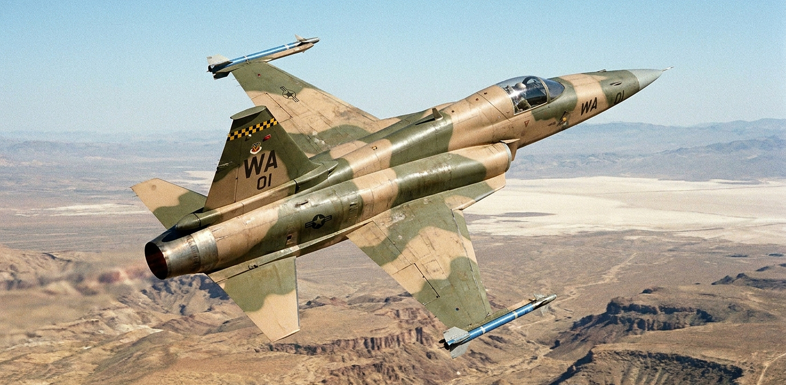

# Northrop F-19 Tigershark

| | |
|:---------- |:------- |
| The **Northrop F-19 Tigershark** is an American single-engine, supersonic lightweight multirole fighter and tactical adversary trainer developed by the [Northrop Corporation](https://en.wikipedia.org/wiki/Northrop_Corporation) in Hawthorne, California. Developed as a modernized, high-performance successor to the ubiquitous [Northrop F-5E Tiger II](https://en.wikipedia.org/wiki/Northrop_F-5), the aircraft replaced the F-5's twin General Electric J85 turbojets with a single, high-thrust [General Electric F404](https://en.wikipedia.org/wiki/General_Electric_F404) afterburning turbofan. Paired with advanced aerodynamics, an enlarged leading-edge root extension (LERX), and the digital [General Electric AN/APG-67](https://en.wikipedia.org/wiki/AN/APG-67) pulse-Doppler multimode radar, the Tigershark achieved Mach 2.1 dash speeds, exceptional instantaneous turn authority, and beyond-visual-range (BVR) missile capability while retaining the austere field footprint and low operating maintenance of its predecessor.  The aircraft owed its commercial and operational viability to the promulgation of **[1976 DSAA Directive 5105.38-M](https://github.com/BJSmithIEEE/AltHist/blob/main/aircraft/1976_DSAA_Directive_5105.38-M.md)** in October 1976. Under the directive's Two-Tier Foreign Military Sales (FMS) framework, the F-19 was certified as the standard American **Tier-2** tactical fighter—designed specifically for point defense, rapid-reaction interception, and austere territorial security. Crucially, the directive's "Aggressor Clause" mandated domestic inventory adoption by the United States Armed Forces, establishing an operational fleet with the [United States Air Force](https://en.wikipedia.org/wiki/United_States_Air_Force)'s 64th and 65th Aggressor Squadrons at Nellis AFB. This domestic adoption resolved prospective buyers' operational risks and anchored the aircraft’s maintenance directly to the [United States Navy](https://en.wikipedia.org/wiki/United_States_Navy)’s extensive F404 depot clearinghouse.  Renowned for its rapid reaction times—capable of cold-starting and climbing to 35,000 feet at Mach 1.5 in under two and a half minutes—the F-19 achieved wide international success. Over its 13-year production run, 544 production airframes were delivered worldwide, including extensive licensed co-production lines in South Korea (*Jegong-II*). The aircraft saw active combat in the Middle East and Latin America, served as a primary dissimilar air combat training (DACT) mount for both the USAF and the U.S. Navy's [Topgun](https://en.wikipedia.org/wiki/United_States_Navy_Strike_Fighter_Tactics_Instructor_program), and remained in front-line allied service well into the 2000s.  The F-19 holds the distinction of being the last frontline American combat aircraft fully funded and developed as a private venture. Financed entirely by Northrop without government cost-plus contracts, it marked the end of an era where a private manufacturer could bring an advanced supersonic fighter to market at its own financial risk. | **Northrop F-19 Tigershark**    *A USAF 64th Aggressor Squadron F-19A Tigershark banks over the Nevada Test and Training Range during Red Flag 82-2.*  **Role**: Tier-2 Lightweight fighter **National origin**: United States  **Manufacturer**: [Northrop Corporation](https://en.wikipedia.org/wiki/Northrop_Corporation)  **Status**: in limited service  **Primary users**:  • [United States Air Force](https://en.wikipedia.org/wiki/United_States_Air_Force) (TAC) • [United States Navy](https://en.wikipedia.org/wiki/United_States_Navy) (Topgun) • [Republic of Korea Air Force](https://en.wikipedia.org/wiki/Republic_of_Korea_Air_Force) • [Egyptian Air Force](https://en.wikipedia.org/wiki/Egyptian_Air_Force)  **Number built**: 544 (incl. 3 refurbished prototypes)  **Produced**: 1979–1992 **First flight**: November 14, 1979  **Introduction**: October 1981 (USAF 64th Aggressor Squadron)   **Program cost**: ~$1.2 billion (private corporate capital)  **Unit cost**:  • **F-19A (Block 1)**: $11.4M flyaway cost (1981) • **F-19C (Block 2)**: $14.2M flyaway (1985)   **Developed from**: [Northrop F-5E Tiger II](https://en.wikipedia.org/wiki/Northrop_F-5)  **Developed into**: [AIDC F-CK-1 Ching-kuo](https://en.wikipedia.org/wiki/AIDC_F-CK-1_Ching-kuo) (via consultation)  **Variants**: RF-19C, KF-19A/B |

## 1976 DSAA Directive 5105.38-M

*Main article:* [1976 DSAA Directive 5105.38-M](https://github.com/BJSmithIEEE/AltHist/blob/main/aircraft/1976_DSAA_Directive_5105.38-M.md)

The development and worldwide proliferation of the F-19 Tigershark were directly enabled by an administrative policy intervention within the Department of Defense. Following a contentious 1976 [General Accounting Office](https://en.wikipedia.org/wiki/Government_Accountability_Office) (GAO) audit (Report B-169832) into irregular Foreign Military Sales practices, Congress and Deputy Secretary of Defense [William P. Clements Jr.](https://en.wikipedia.org/wiki/William_P._Clements_Jr.) enacted **DSAA Directive 5105.38-M (Supplement 4)** on October 18, 1976.

### Quantifying actual F-16 costs
The directive restructured the export market through three interlocking mandates that rescued Northrop’s privately funded light-fighter program from the commercial margin:

1. **Elimination of Subsidized Export Dumping:** The directive strictly enforced Section 21(e) of the [Arms Export Control Act of 1976](https://en.wikipedia.org/wiki/Arms_Export_Control_Act), barring the Air Force from waiving non-recurring research and development (R&D) recoupment surcharges on the [General Dynamics F-16 Fighting Falcon](https://en.wikipedia.org/wiki/General_Dynamics_F-16_Fighting_Falcon). This ended the artificial price deflation that had threatened to undercut privately financed alternatives.
2. **Statutory Capability Stratification:** Tactical exports were segregated into **Tier-1** (high-cost, offensive deep-strike aircraft restricted to high-budget allies) and **Tier-2** (defensive point-interceptors optimized for low operating overhead). The F-19 was designated the benchmark platform for Tier-2 certification, insulating it from direct F-16 competition across middle-tier allied air forces.
3. **The Mandatory Aggressor Clause:** To overcome foreign customers' historic reluctance to purchase American military hardware not operated by the U.S. armed services, Section 4(b) mandated that any certified Tier-2 platform must maintain an active domestic inventory footprint of at least two operational combat squadrons. This spurred a formal Department of Defense procurement contract for USAF adversary training units.

### Navy F404 logistics bridge
A major barrier facing single-engine combat aircraft using newly developed engines was the prohibitive cost of dedicated depot maintenance. Because the USAF had committed its logistical resources entirely to the [Pratt & Whitney F100](https://en.wikipedia.org/wiki/Pratt_%26_Whitney_F100) engine powering the F-15 and F-16, Tactical Air Command resisted funding a parallel depot pipeline for a small fleet of General Electric F404 turbofans.

Directive 5105.38-M resolved this impasse by directing the Air Force's domestic F-19 fleet to integrate directly into the [Naval Air Systems Command](https://en.wikipedia.org/wiki/Naval_Air_Systems_Command) (NAVAIR) logistics clearinghouse established for the twin-engine [McDonnell Douglas F/A-18 Hornet](https://en.wikipedia.org/wiki/McDonnell_Douglas_F/A-18_Hornet). Under this inter-service depot-sharing agreement, all F404 engine modules, depot overhauls, software updates, and component reliability programs were centrally managed through the Navy’s depot at Naval Air Station Alameda and the Naval Air Warfare Center.

By tying the Tigershark’s powerplant directly to the U.S. Navy's multi-thousand-engine carrier fleet, the directive eliminated the stigma of the "orphan aircraft." Foreign purchasers were guaranteed that F404 components, spare parts pools, and technical bulletins would remain fully subsidized, globally available, and supported through the Pentagon’s standard supply channels for decades.

## Design and development

### Origins and Project P-630
In the mid-1970s, as front-line air forces began transitioning to fourth-generation fighters, [Northrop](https://en.wikipedia.org/wiki/Northrop_Corporation) evaluated modernization paths for its prolific [F-5E/F Tiger II](https://en.wikipedia.org/wiki/Northrop_F-5) export family. While the F-5E remained popular with over thirty allied air forces due to its low operating costs and high mission-capable rates, its twin [General Electric J85](https://en.wikipedia.org/wiki/General_Electric_J85) turbojets lacked the thrust necessary to maintain parity with emerging Soviet threats, such as the variable-geometry [Mikoyan-Gurevich MiG-23](https://en.wikipedia.org/wiki/Mikoyan-Gurevich_MiG-23).

Northrop engineers, led by Vice President of Engineering Welko Gasich, initially examined several clean-sheet concepts. These included Project P-610, a high-wing, single-engine derivative of the twin-engine [YF-17](https://en.wikipedia.org/wiki/Northrop_YF-17). However, corporate leadership rejected the P-610 in late 1975 because it required entirely new production tooling and directly encroached upon the carrier-capable [McDonnell Douglas F/A-18 Hornet](https://en.wikipedia.org/wiki/McDonnell_Douglas_F/A-18_Hornet) then under joint development with [McDonnell Douglas](https://en.wikipedia.org/wiki/McDonnell_Douglas). Instead, Northrop launched **Project P-630**, a design that retained the manufacturing infrastructure, low-wing planform, and core cockpit geometry of the F-5E while completely re-engineering the propulsion, aerodynamics, and structural load paths around a single high-bypass afterburning turbofan.

### Airframe and propulsion integration
The central engineering challenge of Project P-630 was accommodating a single large powerplant within an airframe originally tailored around two slender turbojets. Northrop selected the newly developed [General Electric F404](https://en.wikipedia.org/wiki/General_Electric_F404) afterburning turbofan. Developed under U.S. Navy contracts for the twin-engine F/A-18, the F404 generated 16,000 lbf (71.2 kN) of thrust in its initial -GE-100 configuration—an 80 percent increase in total thrust over the F-5E's twin J85s, with a substantial reduction in specific fuel consumption.

Integrating the single engine required redesigning the center and aft fuselage. Engineers eliminated the central structural keel between the old J85 bays and installed a load-bearing titanium carry-through frame to support the single engine mount and nozzle. The engine was fed by enlarged, bifurcated side air intakes with fixed compression ramps optimized for high-transonic and supersonic airflow. Because the F404 required significantly more mass airflow than the J85s, the fuselage cross-section was widened along the engine bays, incorporating pronounced transonic area ruling ("wasp-waisting") to delay compressibility shock waves and reduce transonic wave drag. To cool the engine bay during low-speed ground operations, spring-loaded secondary air-intake blow-in doors were added along the aft fuselage sides, snapping shut automatically as dynamic ram-air pressure built during flight.

### Aerodynamics and flight controls
To exploit the dramatic power-to-weight increase, Northrop substantially modified the wing planform and forward fuselage aerodynamics. The small wing-root strakes of the F-5E were replaced with large, curved **leading-edge root extensions (LERX)** that swept forward along the fuselage to the cockpit sill. At elevated angles of attack (AoA), these enlarged LERX generated powerful, tightly coiled vortices that swept across the upper wing surfaces, delaying boundary-layer separation and maintaining lift up to 38° usable AoA.

The forward radome was re-lofted into a distinctive flattened, oval cross-section featuring subtle horizontal side chines, commercially branded by Northrop as the **"shark nose"**. This geometry fixed the separation point of nose vortices at extreme pitch attitudes, preventing asymmetric vortex shedding that traditionally induced dangerous uncommanded yaw and directional instability at high angles of attack.

Unlike the pure mechanical linkages of the Tiger II, the Tigershark incorporated a hybrid flight-control system. Pitch control was managed through a dual-channel, analog fly-by-wire (FBW) stability augmentation system that commanded the all-moving horizontal tailerons, allowing the aircraft to be configured with relaxed static longitudinal stability for rapid pitch-up rates. Roll and yaw controls retained hydro-mechanical linkages with dual-redundant hydraulic actuators, preserving pilot control feel and allowing safe manual recovery even in the event of an electrical bus failure.

### Evolutionary tiers: Propulsion, avionics, and performance
Northrop was expected to meet introduction dates for the Tier-2 export offering, so its accelerated development schedule brought the F-19 to flight test ahead of digital control and radar developments of the 1980s. The aircraft matured across two distinct technological and propulsion tiers:

**Block 1 baseline (F-19A single-seat and F-19B two-seat):**

Initial production Block 1 aircraft were powered by the 16,000 lbf (71.2 kN) **General Electric F404-GE-100** afterburning turbofan. In clean configuration, the -100 engine gave the F-19A an impressive thrust-to-weight ratio of 1.06:1 and a high-altitude level top speed of **Mach 2.04** at 36,000 ft. However, acceleration above Mach 1.8 was relatively gradual, and the carriage of external ordnance noticeably lengthened climb profiles.

Avionics on Block 1 reflected late-1970s technology. The cockpit retained traditional electro-mechanical round-dial flight instruments and vertical tape engine indicators closely derived from the F-5E, supplemented by an electro-optical Kaiser Head-Up Display (HUD). The three prototypes in 1979, and then refurishment of them into F-19A (Block 1) aircraft in late 1980, along with the and initial deliveries of the other thirty-tree aircraft through 1981 were USAF adversary deliveries to the 64th Aggressor Squadron at Nellis AFB. These omitted the radar entirely, and flew with nose ballast, an AN/ALR-69 radar warning receiver, and external telemetry pods to minimize procurement costs for visual dissimilar air combat training (DACT).

Export Block 1 fighters built by Northrop 1982-1984, as well as built under license, were equipped with an early-production, analog-digital hybrid **General Electric AN/APG-67(V)** radar. This baseline sensor provided basic pulse search, air-to-ground ranging, and continuous-wave (CW) illumination for the semi-active radar-homing [AIM-7F Sparrow](https://en.wikipedia.org/wiki/AIM-7_Sparrow), presenting target data on a dedicated monochromatic cockpit radar scope.

**Block 2 digital leap (F-19C single-seat and F-19D two-seat):**

Introduced in the mid-1980s, the definitive Block 2 standard adopted the uprated **General Electric F404-GE-402 Enhanced Performance Engine (EPE)**, boosting afterburning thrust by 11 percent to 17,700 lbf (78.7 kN). This powerplant transformation fundamentally altered the Tigershark's energy-maneuverability profile. With the -402, maximum level speed increased to **Mach 2.10–2.12**, but the most consequential gains occurred in intermediate acceleration: time to accelerate from Mach 0.9 to Mach 1.6 in level flight was reduced by nearly 30 percent, and the aircraft achieved its signature alert intercept performance—accelerating from a cold engine start on the runway to 35,000 ft at Mach 1.5 in under 2.5 minutes.

Block 2 paired this extra thrust with an overhaul of its systems. The cockpit transitioned to a fully integrated digital glass environment built around a [MIL-STD-1553B](https://en.wikipedia.org/wiki/MIL-STD-1553) multiplex databus, dual 5-inch monochrome cathode-ray tube (CRT) Multi-Function Displays (MFDs), and full Hands On Throttle-And-Stick (HOTAS) switchgear. The radar was upgraded to the mature **AN/APG-67(V)2**, introducing digital signal processing (DSP), true look-down/shoot-down ground-clutter rejection, automated track-while-scan (TWS), and software datalink provisions for the [AIM-120 AMRAAM](https://en.wikipedia.org/wiki/AIM-120_AMRAAM). Navigation was upgraded with a Honeywell ring-laser gyro inertial navigation system (INS), and the airframe shared identical engine depot servicing with the U.S. Navy's newly introduced F/A-18C/D.

The F-19C/D (Block 2) was the first dedicated adversary platform equipped with an operational multi-mode radar to conduct beyond-visual-range (BVR) aggressor training. Initially spearheaded by the U.S. Navy—which operated Block 2 airframes designated **F-19N**—these aircraft accurately simulated the radar-guided missile threat posed by the Soviet [Mikoyan-Gurevich MiG-23](https://en.wikipedia.org/wiki/Mikoyan-Gurevich_MiG-23) and emerging fourth-generation fighters. Concurrently, Senate Armed Services Committee pressure compelled the Air Force to procure an additional **18 F-19C/D Block 2 aircraft** (bringing the USAF fleet to **54 total**). This acquisition allowed Tactical Air Command to introduce BVR threat presentation at Nellis AFB while rotating 18 earlier F-19A/B Block 1 airframes to United States Air Forces in Europe (USAFE) with the 527th Aggressor Squadron at RAF Alconbury.

A USAF Block 2 aggressor later served as the primary test platform to qualify the [AIM-120 AMRAAM](https://en.wikipedia.org/wiki/AIM-120_AMRAAM) for the Tigershark family.

### Flight testing and the G-LOC controversy
Northrop built three production-representative Full-Scale Development (FSD) airframes—designated under the experimental ledger as **YF-19A** (airframes *77-0191*, *77-0192*, and *77-0193*)—on production tooling at Hawthorne. Built without radar sets and fitted with nose ballast and flight-test telemetry equipment, the aircraft were transported overland to the Air Force Flight Test Center at [Edwards Air Force Base](https://en.wikipedia.org/wiki/Edwards_Air_Force_Base), California.

The first prototype (*77-0191*) conducted its maiden flight on November 14, 1979, piloted by Northrop chief test pilot Hank Chouteau. Testing confirmed the aerodynamic predictions: instantaneous turn rates exceeded 20° per second, stall-free throttle transients were demonstrated throughout the entire flight envelope, and level-flight dash reached Mach 2.04 on the initial F404-GE-100 engine.

However, the aircraft’s high agility triggered technical and political friction during joint Tactical Air Command (TAC) trials in early 1981. During simulated combat against USAF [F-15 Eagles](https://en.wikipedia.org/wiki/McDonnell_Douglas_F-15_Eagle), an evaluation pilot experienced a momentary, non-fatal incident of **G-induced loss of consciousness (G-LOC)**. The Tigershark’s instantaneous pitch onset rate—capable of snapping from 1G to its structural limit of 9G in under one second—exceeded the human circulatory system’s ability to compensate through standard anti-G straining maneuvers.

Skeptics within the Air Staff seized upon the incident to criticize the F-19's physical architecture, arguing that its cramped cockpit tub was an obsolete legacy design that could not accommodate an [F-16](https://en.wikipedia.org/wiki/General_Dynamics_F-16_Fighting_Falcon)-style 30° reclined seat, raised rudder pedals, or a side-stick controller. Because the Tigershark preserved the compact forward fuselage geometry of the F-5E, raising the cockpit floor was structurally impossible due to the nose gear well and the internal 20 mm cannon bays directly below, while adopting an extreme recline would have caused the pilot's body to physically block full aft travel of the traditional center-mounted control stick. Air Force officials attempted to leverage these physical limitations to brand the jet "dangerously over-responsive" for mid-tier allied pilots and delay further procurement.

Northrop and the USAF School of Aerospace Medicine mounted an aggressive defense, proving that radical cockpit redesigns were unnecessary. Instead, engineers developed an austere, highly effective ergonomic compromise:
* **19-degree seat tilt:** Northrop re-angled the ejection seat guide rails from the baseline 13° to a **19° reclined posture**—the maximum angle achievable without impeding full aft stick deflection, degrading over-the-nose landing sightlines, or interfering with canopy jettison clearances. This modest recline significantly shortened the vertical hydrostatic column between the pilot's heart and brain.
* **Fast-response micro-valves:** A rapid-inflation digital anti-G valve replaced sluggish mechanical valves, inflating the pilot’s G-suit instantaneously upon initial stick backpressure.
* **Fly-by-wire onset dampening & auto-recovery:** The analog flight-control computer was refined with a microsecond-scale G-onset smoothing curve and an automatic wings-leveling recovery function that engaged if stick inputs ceased during sustained high-G turns.

Far from being a liability, the controversy highlighted the aircraft's exceptional energy-maneuverability. Independent evaluations by the Defense Security Assistance Agency (DSAA) noted that the F-19 delivered true fourth-generation turn performance alongside sub-three-minute alert scramble times and unprecedented ease of maintenance—demanding less than half the maintenance man-hours per flight hour (MMH/FH) of an F-16 or F-15. These qualities made the airframe ideal for less technologically sophisticated allied air forces requiring high-readiness point defense. 

Satisfied with the aeromedical modifications, the Air Force certified the flight envelope in mid-1981. In accordance with Directive 5105.38-M's domestic inventory mandate, all three FSD airframes were stripped of specialized test gear, refurbished to operational standards, and delivered alongside the first production batch to the 64th Aggressor Squadron at [Nellis Air Force Base](https://en.wikipedia.org/wiki/Nellis_Air_Force_Base) in late 1981.

## Market comparison

Under the statutory mandates of Directive 5105.38-M, international combat aircraft exports were strictly divided into **Tier-1** (high-performance deep strike) and **Tier-2** (austere point defense), while mandatory non-recurring R&D recoupment fees and 20-year lifecycle affordability audits ended the era of subsidized fighter dumping. By anchoring the F-19 to the U.S. Navy's high-volume F404 depot clearinghouse and commercial F-5 tooling, Northrop positioned the Tigershark as the dominant low-maintenance, high-readiness solution for mid-tier allied budgets.

The table below contrasts the F-19 with contemporary Western fighter alternatives available across international defense sales during the 1980s:

| Aircraft | Export Tier Classification | Unit Flyaway Cost *(1982 USD)* | Maintenance Burden *(MMH/FH)* | 20-Year Lifecycle Affordability & Operational Niche |
| :--- | :--- | :--- | :--- | :--- |
| **LTV A-7F Strikefighter** | **Tier-2 / Remanufacture** *(Supersonic Maritime Strike)* | **$6.8M** *(depot conversion kit)* | **11.5** | Low-cost remanufactured supersonic conversion (Project V-550). Provided Mach 1.19 dash, AN/APG-66 radar, and Harpoon/Exocet maritime strike for existing Corsair operators at 30% of new-build fighter costs. |
| **Northrop F-19A Tigershark** | **Tier-2** *(Austere Point Defense)* | **$11.4M** | **8.2** | Benchmark Tier-2 export fighter. Lowest acquisition and operating cost in class; sub-2.5-minute alert scramble; shared F404 depot overhauls with USN F/A-18s; ideal for austere-strip point defense. |
| **Northrop F-19C (Block 2)** | **Tier-2** *(Modernized Multi-Role)* | **$14.2M** | **9.4** | Modernized digital glass cockpit, AN/APG-67(V)2 radar, and AIM-120 AMRAAM capability on an austere footprint. Squeezed out the Mirage 2000 in cost-conscious competitions. |
| **General Dynamics F-16A (Block 15)** | **Tier-1** *(Multi-Role Fighter)* | **$16.8M** *(incl. mandatory $2.1M R&D recoupment)* | **19.5** | High-performance multirole fighter. Disqualified from credit-strapped nations due to strict 20-year lifecycle audits (F100 engine overhauls, automated test station cleanrooms, and high flight-hour burn). |
| **Dassault Mirage 2000E** | *Non-U.S. / French Benchmark* | **$21.0M** | **18.0** | Caught in an acute commercial vise: outranged in high-end strike competitions by the F-16E and F-15, while undercut in acquisition and hourly flight costs by the F-19 and A-7F conversion. |
| **General Dynamics F-16E Freedom Falcon** | **Tier-1** *(Deep-Strike Interdictor)* | **$23.5M** | **22.0** | Cranked-arrow heavy strike derivative developed to escape the Tier-2 squeeze. Delivered 720 nmi unrefueled combat radius and 15,000 lb ordnance on a single F110 engine, bypassing F-15E export bans and beating the F/A-18 on range. |
| **McDonnell Douglas F/A-18A Hornet** | **Tier-1** *(Carrier / Maritime Multi-Role)* | **$24.5M** | **24.0** | Premium twin-engine carrier fighter. Procured by wealthy Tier-1 allies (Canada, Australia, Spain) demanding twin-engine overwater safety, long-range radar search, and heavy ordnance carriage. |
| **McDonnell Douglas F-15A Eagle** | **Tier-1** *(Heavy Air Superiority)* | **$28.2M** | **32.5** | Premium twin-engine air superiority fighter. Restricted to wealthy Tier-1 allies (Japan Peace Eagle, Israel Peace Fox, Saudi Arabia Peace Sun); exceptional climb, radar reach (AN/APG-63), and BVR performance, but severely cost-prohibitive for non-aligned or budget-constrained air arms. |
| **McDonnell Douglas F-15E Strike Eagle** | **Tier-1** *(All-Weather Deep Strike)* | **$43.0M+** | **38.0** | Dual-role heavy interdictor. Massive 24,500 lb weapons payload, LANTIRN terrain-following suite, and extreme unrefueled radius. Highly restricted by U.S. State Department and congressional vetoes; acquisition and sustainment costs excluded all but the wealthiest allied militaries, directly creating the export demand for the single-engine F-16E. |

### Competitive dynamics
* **The Tier-1 / Tier-2 bifurcation:** By enforcing Section 6(c) lifecycle audits, DSAA barred developing nations with constrained defense budgets from spending Military Assistance Program credits on high-burn platforms like the F-16A or heavy twin-engine fighters like the F-15. This channeled traditional F-5 and Mirage III operators directly toward the F-19.
* **The High-End Strike Vise:** While the F-15A and F-15E represented the apex of Tier-1 tactical capability, their extreme flyaway price tags and intensive depot footprints (nearly 40 MMH/FH for the Strike Eagle) left them accessible only to a select few. When congressional committees blocked broad Middle Eastern sales of the F-15E to protect regional balances, General Dynamics capitalized on the vacuum by developing the cranked-arrow F-16E Freedom Falcon—delivering comparable interdiction range on a single engine at roughly half the unit cost.
* **The Middle-Tier squeeze:** General Dynamics was blocked from dumping discounted baseline F-16s into developing markets. This forced Fort Worth to adapt by moving upmarket with the F-16E for wealthy strike-oriented buyers, while LTV cornered the low-cost strike market by modernizing customer-owned A-7 airframes.
* **Impact on European exports:** The availability of the certified, F404-backed F-19 undercut Dassault’s traditional Mirage F1 customer base in the Middle East and Latin America, while the A-7F Strikefighter and F-16E severely compressed export opportunities for the early Mirage 2000.

## Operational history

> *Main article: [Northrop F-19 Tigershark in Combat Operations](https://github.com/BJSmithIEEE/AltHist/blob/main/aircraft/Northrop_F-19_Tigershark_in_Combat_Operations.md)*

The operational career of the F-19 Tigershark spanned four decades, encompassing intense Cold War air-defense alert deployments, dissimilar air combat training (DACT), regional shooting wars across three continents, and a prolonged private adversary afterlife. Designed with a sub-three-minute alert scramble capability, high subsonic turn performance, and an austere maintenance footprint, the Tigershark was employed primarily in frontline quick-reaction alert (QRA), perimeter air sovereignty, and aggressive adversary presentation.

### Adversary and flight training
* **United States Air Force:** Entering service in late 1981, the F-19 served with the 64th and 65th Aggressor Squadrons at [Nellis Air Force Base](https://en.wikipedia.org/wiki/Nellis_Air_Force_Base), Nevada, simulating early-generation Soviet [MiG-21](https://en.wikipedia.org/wiki/Mikoyan-Gurevich_MiG-21) and [MiG-23](https://en.wikipedia.org/wiki/Mikoyan-Gurevich_MiG-23) threats during Red Flag exercises. In Europe, the 527th Aggressor Squadron at [RAF Alconbury](https://en.wikipedia.org/wiki/RAF_Alconbury) rotated 18 early F-19A/B airframes across NATO bases to provide visual DACT against frontline F-15, F-16, and Tornado aircrews. The later addition of 18 F-19C/D Block 2 airframes introduced operational beyond-visual-range (BVR) radar simulation and served as the primary qualification bed for the [AIM-120 AMRAAM](https://en.wikipedia.org/wiki/AIM-120_AMRAAM).
* **United States Navy:** Designated **F-19N**, 36 new-build and 18 ex-USAF Block 2 airframes operated with the Navy Fighter Weapons School ([Topgun](https://en.wikipedia.org/wiki/United_States_Navy_Strike_Fighter_Tactics_Instructor_program)) and fleet adversary squadrons VF-43 and VFC-13 from 1982 to 2008. The F-19N provided demanding BVR threat presentation while sharing complete F404 powerplant and depot maintenance facilities with the fleet's carrier-based F/A-18 Hornets.
* **Commercial ADAIR:** Following military retirements between 2008 and 2014, commercial contractors [Draken International](https://en.wikipedia.org/wiki/Draken_International) and [Tactical Air Support (TacAir)](https://en.wikipedia.org/wiki/Tactical_Air_Support) acquired approximately 45 surplus airframes from Greece, Kuwait, and Switzerland. Modernized with open-architecture radar emulators and electronic attack pods, these aircraft fly contracted adversary sorties against fifth-generation [F-22](https://en.wikipedia.org/wiki/Lockheed_Martin_F-22_Raptor) and [F-35](https://en.wikipedia.org/wiki/Lockheed_Martin_F-35_Lightning_II) fighters.

### Middle East and Persian Gulf
* **Iran–Iraq War:** The Kuwait Air Force operated F-19A Block 1s on round-the-clock combat air patrols (CAP) to enforce border integrity and protect offshore oil infrastructure during the "Tanker War," conducting multiple visual-range intercepts and driving off probing Iranian F-4 Phantom IIs.
* **Gulf War (1990–1991):** During the August 1990 Iraqi invasion of Kuwait, Kuwaiti F-19As scrambled from Ali Al Salem and Ahmed Al Jaber Air Bases, engaging advancing Iraqi armored columns and air assault helicopters with 20 mm cannons and Mk 82 bombs. During the chaotic defensive sorties, Kuwaiti Tigersharks claimed three Iraqi [Mil Mi-8](https://en.wikipedia.org/wiki/Mil_Mi-8) and [Mi-24](https://en.wikipedia.org/wiki/Mil_Mi-24) helicopters before surviving airframes evacuated to Saudi Arabia to form the "Free Kuwait" air wing, subsequently flying coalition combat air patrols during Operation Desert Storm.
* **Nile Valley and Western Sahara:** Egyptian Air Force F-19As maintained continuous border alert along the Libyan frontier, while Royal Moroccan Air Force Tigersharks flew armed reconnaissance and perimeter interdiction along the Berm in Western Sahara.

### East Asia and Alpine Europe
* **Korean Demilitarized Zone (DMZ):** The Republic of Korea Air Force deployed the F-19A and license-built KF-19 *Jegong-II* along frontline bases at Suwon, Gangneung, and Jungwon. Operating on perpetual five-minute alert, ROKAF Tigersharks logged hundreds of intercepts against North Korean MiG-21s and MiG-23s probing the Northern Limit Line (NLL), with modernized *Jegong-III* aircraft maintaining BVR deterrence into the late 2010s.
* **Indochina Border Clashes:** Royal Thai Air Force F-19As from Wing 1 at Korat flew armed border sweeps and visual air policing along the Cambodian frontier in the mid-1980s, countering Vietnamese airspace incursions and supporting Royal Thai Army ground operations.
* **Swiss Alpine Neutrality:** The Swiss Air Force integrated 42 F-19s into its hardened alpine cavern complex and highway dispersal system, executing austere, sub-three-minute snow-strip alert scrambles over the Alps alongside the Mirage IIIS until replaced by the F/A-18 Hornet in 2006.

## End of production and retirement

### Production closure and line transition
Serial assembly of the Tigershark family concluded in December 1992 at Northrop’s Hawthorne, California facility, barely preceded by the completion of licensed Korean co-production runs at Korean Air Lines' Pusan plant in 1991. Global production ceased after delivering **544 total airframes** (including three Full-Scale Development prototypes, 90 domestic U.S. military deliveries, and 454 international aircraft). 

The termination of new-build airframe manufacturing was driven primarily by geopolitical shifts rather than performance shortfalls. With the dissolution of the Warsaw Pact and the conclusion of the Cold War, allied defense budgets contracted severely. Simultaneously, the global fighter export market was flooded with cut-rate surplus aircraft, including discounted early-block [General Dynamics F-16 Fighting Falcons](https://en.wikipedia.org/wiki/General_Dynamics_F-16_Fighting_Falcon) released from shrinking U.S. and NATO front-line inventories, as well as de-alerted Soviet [Mikoyan MiG-29s](https://en.wikipedia.org/wiki/Mikoyan_MiG-29). 

Recognizing that the post–Cold War market for new-build lightweight point-defense fighters had largely evaporated, Northrop formally closed the Tigershark manufacturing tooling to repurpose facility space and capital toward its prime contractor responsibilities on the [Northrop Grumman B-2 Spirit](https://en.wikipedia.org/wiki/Northrop_Grumman_B-2_Spirit) stealth bomber program and the joint [McDonnell Douglas/Northrop YF-23](https://en.wikipedia.org/wiki/Northrop_YF-23) Advanced Tactical Fighter competition.

### Military retirement and service life
Active-duty military retirement occurred in phased waves as airframes exhausted their fatigue life or were superseded by larger multirole strike platforms:

* **United States military:** The U.S. Air Force retired its last active-duty F-19A/B Block 1 airframes from the 64th and 65th Aggressor Squadrons at Nellis AFB between 1999 and 2002. Having logged hundreds of thousands of high-G adversary sorties, several dozen surviving airframes with high remaining structural fatigue life were transferred to U.S. Navy inventory. The U.S. Navy operated its combined fleet of new-build F-19Ns and ex-USAF Block 2 airframes across Topgun (NAS Fallon) and adversary squadrons VFC-12 and VFC-13 until 2008, when the airframes finally reached their 8,000-hour fatigue limit.
* **Middle East and Europe:** In the Middle East, the Kuwait Air Force phased out its surviving F-19s during the early 2000s in favor of an all-Boeing F/A-18C/D Hornet fleet. The Swiss Air Force concluded its alpine quick-reaction alert (QRA) missions with the F-19 in 2006, consolidating its fighter force around the F/A-18C/D Hornet. The Hellenic Air Force decommissioned its 111th Combat Wing F-19A Block 1s in 2008 after fully integrating its LTV A-7FH Strikefighter, Mirage 2000, and F-16E fleets.
* **Asia:** The Republic of Korea Air Force remained the longest-serving military frontline operator. Upgraded under the domestic *Jegong-III* program with modernized indigenous radar processing, Link-K datalinks, and precision-guided glide bomb capabilities, the ROKAF kept its KF-19 fleet on 24/7 five-minute DMZ alert until initiating a phased phaseout in 2018 in favor of the [KAI FA-50 Golden Eagle](https://en.wikipedia.org/wiki/KAI_T-50_Golden_Eagle) and the [KF-21 Boramae](https://en.wikipedia.org/wiki/KAI_KF-21_Boramae).

### Commercial ADAIR afterlife
Unlike many retired Cold War combat platforms that were scrapped or consigned to desert storage at the [309th AMARG](https://en.wikipedia.org/wiki/309th_Aerospace_Maintenance_and_Regeneration_Group), the F-19 found a lucrative second operational career in the private sector. Between 2008 and 2014, commercial adversary air (ADAIR) contractors—principally [Draken International](https://en.wikipedia.org/wiki/Draken_International) and [Tactical Air Support (TacAir)](https://en.wikipedia.org/wiki/Tactical_Air_Support)—purchased approximately 45 surplus airframes from the governments of Greece, Kuwait, and Switzerland. 

Because these export nations flew their Tigersharks predominantly in austere point-defense and peacetime air-policing profiles, the airframes retained substantial structural margins. The private contractors integrated open-architecture commercial-off-the-shelf (COTS) computing, civil instrument flight rules (IFR) navigation suites, tactical electronic attack pods, and radar threat emulators. Operating under multi-year adversary support contracts for the U.S. Air Force, U.S. Navy, and Air National Guard, these privately owned F-19s continue to provide cost-effective supersonic "Red Air" threat presentation against fifth-generation [F-22 Raptor](https://en.wikipedia.org/wiki/Lockheed_Martin_F-22_Raptor) and [F-35 Lightning II](https://en.wikipedia.org/wiki/Lockheed_Martin_F-35_Lightning_II) fighters.

## Variants

### YF-19A
Three Full-Scale Development (FSD) prototypes (*77-0191*, *77-0192*, and *77-0193*) built on production tooling at Northrop's Hawthorne facility. Completed without radar systems, the aircraft flew with nose ballast and dedicated flight-test telemetry equipment to validate high-AoA aerodynamics, F404-GE-100 engine integration, and high-G structural limits. Following flight qualification at Edwards AFB, all three airframes were refurbished to operational standards and delivered to the USAF 64th Aggressor Squadron at Nellis AFB in late 1981, remaining in active adversary service throughout their fatigue life.

### F-19A (Block 1)
Initial single-seat production export baseline (288 built between 1978 and 1984). Powered by the 16,000 lbf (71.2 kN) General Electric F404-GE-100 afterburning turbofan, the aircraft featured an analog cockpit with electro-mechanical instrumentation, a Kaiser Head-Up Display (HUD), and a 19° reclined ejection seat. 
* **Export configuration:** Fitted with an early analog-digital hybrid General Electric AN/APG-67(V) pulse-Doppler radar with a continuous-wave (CW) illumination channel, capable of guiding the semi-active radar-homing [AIM-7F Sparrow](https://en.wikipedia.org/wiki/AIM-7_Sparrow) for beyond-visual-range (BVR) point defense.
* **USAF Aggressor configuration:** Built without tactical fire-control radar sets to minimize procurement cost for visual Dissimilar Air Combat Training (DACT), using nose ballast and an AN/ALR-69 radar warning receiver.

### F-19B (Block 1)
Two-seat operational conversion trainer counterpart to the F-19A Block 1 (42 built). The fuselage was stretched by 3 feet 2 inches (0.97 m) to accommodate a stepped tandem dual cockpit with duplicate controls and instrumentation, reducing internal fuel capacity by approximately 10 percent. Retained the single F404-GE-100 engine and full weapons capability, with twin 20 mm cannons preserved.

### F-19C (Block 2)
Definitive modernized single-seat multirole production standard introduced in 1984 (118 built). Upgraded with the 17,700 lbf (78.7 kN) General Electric F404-GE-402 Enhanced Performance Engine (EPE), boosting top speed to Mach 2.1 and significantly shortening transonic acceleration and scramble times. 
* **Avionics & Cockpit:** Replaced analog gauges with a digital glass cockpit centered on a [MIL-STD-1553B](https://en.wikipedia.org/wiki/MIL-STD-1553) multiplex databus, dual 5-inch monochrome CRT Multi-Function Displays (MFDs), and full HOTAS controls.
* **Sensor Suite:** Upgraded to the fully digital AN/APG-67(V)2 pulse-Doppler radar, adding digital track-while-scan (TWS), look-down/shoot-down performance in dense clutter, sea-surface search, and software datalink provisions for the [AIM-120 AMRAAM](https://en.wikipedia.org/wiki/AIM-120_AMRAAM).

### F-19D (Block 2)
Two-seat combat-capable operational trainer counterpart to the F-19C Block 2 (24 built). Featured the stretched two-seat fuselage, dual digital glass cockpits, the F404-GE-402 engine, and the AN/APG-67(V)2 radar suite.

### F-19N (Block 2)
Dedicated adversary training variant operated by the [United States Navy](https://en.wikipedia.org/wiki/United_States_Navy) (54 airframes total). Under the 1976 Clements Compromise, the Navy initially procured 36 new-build F-19N airframes for the Navy Fighter Weapons School ([Topgun](https://en.wikipedia.org/wiki/United_States_Navy_Strike_Fighter_Tactics_Instructor_program)) at NAS Miramar (later NAS Fallon) and fleet adversary squadrons VF-43 and VFC-13. An additional 18 late-model Block 2 airframes were acquired in 1994 via inter-service transfer from the USAF to replace prematurely retired, fatigue-cracked F-16Ns. Equipped with the AN/APG-67(V)2 radar, the F-19N accurately emulated fourth-generation Soviet BVR threats, benefiting from complete propulsion and maintenance commonality with the Navy's carrier-based [F/A-18 Hornet](https://en.wikipedia.org/wiki/McDonnell_Douglas_F/A-18_Hornet) fleet.

### RF-19C Eye Shark
Specialized tactical photo-reconnaissance variant developed for export customers (16 built, plus conversion kits). The twin 20 mm nose cannons were removed to install a modular electro-optical and forward-looking infrared (FLIR) panoramic sensor package in the lower nose bay, complemented by a real-time high-speed digital datalink for rapid ground-station tactical dissemination.

### KF-19A/B Jegong-II (제공-II)
Licensed co-production variant manufactured in South Korea by Korean Air Lines (KAL) Aerospace Division at Pusan for the [Republic of Korea Air Force](https://en.wikipedia.org/wiki/Republic_of_Korea_Air_Force) (ROKAF) (68 airframes: 52 KF-19A single-seaters and 16 KF-19B two-seaters). Designated *Jegong-II* ("Winning the Sky-II") as the direct successor to the KF-5E/F *Jegong-I*, the Korean-assembled airframes featured indigenous wiring harnesses, license-built Samsung-GE F404 engines, and local integration of Korean-manufactured tactical radio and secure datalink hardware.

### KF-19C/E Jegong-III (제공-III)
Mid-life upgrade (MLU) program executed by [Korea Aerospace Industries](https://en.wikipedia.org/wiki/Korea_Aerospace_Industries) (KAI) and LIG Nex1 in the late 1990s and early 2000s across surviving ROKAF airframes. The upgrade replaced early radar hardware with an indigenous pulse-Doppler radar suite featuring active electronically scanned array (AESA) processing elements, integrated a domestic mission computer with Link-K secure tactical datalinks, added Helmet-Mounted Cueing Systems (HMCS), and wired the wing stations to support the [AIM-9X Sidewinder](https://en.wikipedia.org/wiki/AIM-9_Sidewinder), Python-4, and the Korean GPS-Guided Bomb (KGGB). This enabled the ROKAF to maintain the Tigershark as a high-readiness, cost-effective frontline border interceptor until its eventual replacement by the [KAI FA-50](https://en.wikipedia.org/wiki/KAI_T-50_Golden_Eagle) and [KF-21 Boramae](https://en.wikipedia.org/wiki/KAI_KF-21_Boramae).

## Operators

### Current operators

**Bahrain**

* [Royal Bahraini Air Force](https://en.wikipedia.org/wiki/Royal_Bahraini_Air_Force) – 16 aircraft delivered (12 F-19C Block 2, 4 F-19D Block 2). Stationed at Isa Air Base for high-readiness Persian Gulf point defense and maritime air surveillance.

**Brazil**

* [Brazilian Air Force](https://en.wikipedia.org/wiki/Brazilian_Air_Force) – 36 aircraft delivered (30 F-19A Block 1, 6 F-19B Block 1). Replaced early Mirage IIIEBR airframes; operating primarily with the 1º Grupo de Aviação de Caça at Santa Cruz Air Base alongside modern F-5EM fleets.

**Egypt**

* [Egyptian Air Force](https://en.wikipedia.org/wiki/Egyptian_Air_Force) – 64 aircraft delivered (54 F-19A Block 1, 10 F-19B Block 1). Procured under Foreign Military Sales post-Camp David as a cost-effective high-low mix alongside early F-16s, replacing Soviet-built MiG-21 and Su-7 fleets for Nile Valley point defense.

**Jordan**

* [Royal Jordanian Air Force](https://en.wikipedia.org/wiki/Royal_Jordanian_Air_Force) – 24 aircraft delivered (20 F-19A Block 1, 4 F-19B Block 1). Stationed at Muwaffaq Salti Air Base to provide austere, low-cost beyond-visual-range border defense.

**Malaysia**

* [Royal Malaysian Air Force](https://en.wikipedia.org/wiki/Royal_Malaysian_Air_Force) – 24 aircraft delivered (20 F-19A Block 1, 4 F-19B Block 1). Operated by No. 12 Squadron out of Butterworth Air Base for maritime border patrol and airspace integrity over the South China Sea.

**Morocco**

* [Royal Moroccan Air Force](https://en.wikipedia.org/wiki/Royal_Moroccan_Air_Force) – 20 aircraft delivered (16 F-19A Block 1, 4 F-19B Block 1). Based at Ben Guerir Air Base to secure southern borders and conduct regional air-defense patrols.

**Thailand**

* [Royal Thai Air Force](https://en.wikipedia.org/wiki/Royal_Thai_Air_Force) – 36 aircraft delivered (30 F-19A Block 1, 6 F-19B Block 1). Operated by Wing 1 at Korat alongside supersonic LTV A-7FT Strikefighters, serving as rapid-scramble border alert interceptors.

### Former operators

**Greece**

* [Hellenic Air Force](https://en.wikipedia.org/wiki/Hellenic_Air_Force) – 40 aircraft delivered (34 F-19A Block 1, 6 F-19B Block 1). Operated by the 111th Combat Wing at Nea Anchialos from 1981 to 2008 as a quick-reaction alert (QRA) interceptor over the Aegean. Following modernization with A-7FH Strikefighters and procurement of Mirage 2000EGs and F-16Es, Greece retired the fleet in 2008, selling approximately 30 low-hour airframes to U.S. commercial adversary contractors.

**Kuwait**

* [Kuwait Air Force](https://en.wikipedia.org/wiki/Kuwait_Air_Force) – 32 aircraft delivered (26 F-19A Block 1, 6 F-19B Block 1). Flew rapid-scramble intercept missions during the Iran–Iraq War tanker crisis and flew combat sorties against invading Iraqi forces during the 1990 Gulf War; phased out and sold to commercial DACT in the early 2000s, following the arrival of the F/A-18C/D Hornet in the late 1990s.

**South Korea**

* [Republic of Korea Air Force](https://en.wikipedia.org/wiki/Republic_of_Korea_Air_Force) – 120 aircraft operated:
  * 52 direct-purchase Northrop airframes (40 F-19A/C, 12 F-19B/D).
  * 68 license-built KF-19A/B *Jegong-II* airframes co-produced by Korean Air Lines (KAL) Aerospace Division at Pusan.
  * Served as the primary frontline border alert interceptor along the DMZ, subsequently upgraded to the *Jegong-III* standard; phased out in the 2010s in favor of the [KAI FA-50](https://en.wikipedia.org/wiki/KAI_T-50_Golden_Eagle) and [KF-21 Boramae](https://en.wikipedia.org/wiki/KAI_KF-21_Boramae).

**Switzerland**

* [Swiss Air Force](https://en.wikipedia.org/wiki/Swiss_Air_Force) – 42 aircraft delivered (36 F-19A Block 1, 6 F-19B Block 1). Assembled indigenously by [F+W Emmen](https://en.wikipedia.org/wiki/RUAG_Aerospace) for mountain cavern hangars and highway-strip alert operations alongside the Dassault Mirage IIIS; retired in the 2000s, with surplus airframes sold to commercial DACT operators.

**United States**

* [United States Air Force](https://en.wikipedia.org/wiki/United_States_Air_Force) – 54 aircraft operated (1981–2002):
  * 3 YF-19A full-scale development prototypes (refurbished to production standard).
  * 33 F-19A/B Block 1 aircraft operated by the 64th and 65th Aggressor Squadrons at [Nellis Air Force Base](https://en.wikipedia.org/wiki/Nellis_Air_Force_Base), Nevada, with 18 airframes later rotated to the 527th Aggressor Squadron at [RAF Alconbury](https://en.wikipedia.org/wiki/RAF_Alconbury), United Kingdom.
  * 18 F-19C/D Block 2 aircraft procured to introduce radar-guided BVR threat replication at Nellis AFB (transferred to the U.S. Navy in 1994).
* [United States Navy](https://en.wikipedia.org/wiki/United_States_Navy) – 54 aircraft operated (1982–2008):
  * 36 new-build F-19N airframes delivered to the Navy Fighter Weapons School ([Topgun](https://en.wikipedia.org/wiki/United_States_Navy_Strike_Fighter_Tactics_Instructor_program)) at NAS Miramar/Fallon and fleet adversary squadrons VF-43 and VFC-13.
  * 18 F-19C/D Block 2 airframes transferred from the USAF in 1994 to replace fatigue-cracked F-16Ns.

### Private and experimental operators

**United States**

* [NASA](https://en.wikipedia.org/wiki/NASA) – 2 airframes (designated **NF-19A**). Operated by the Dryden Flight Research Center at Edwards AFB for high-angle-of-attack vortex dynamics, automated flight control law evaluation, and supersonic laminar flow experimentation.
* [Draken International](https://en.wikipedia.org/wiki/Draken_International) / [Tactical Air Support (TacAir)](https://en.wikipedia.org/wiki/Tactical_Air_Support) – Approximately 45 surplus airframes acquired from Greece, Kuwait, and Switzerland between 2008 and 2014. Upgraded with commercial-off-the-shelf open-architecture avionics, advanced datalinks, and electronic attack pods, these aircraft fly under Contracted Adversary Air (ADAIR) agreements to provide threat presentation against USAF, USN, and ANG fourth- and fifth-generation fighters.

## Failed bids

### Cancelled orders

**Chile**

* The Chilean Air Force (FACh), an established F-5E operator, actively sought to acquire the F-19 to counter regional air acquisitions in the Southern Cone. However, direct U.S. sales were legally barred under the 1976 Kennedy Amendment, which embargoed military hardware deliveries to the Pinochet regime over human rights concerns. Denied access to new U.S. fighters, Chile retained its F-5E fleet, eventually partnering with Israel Aircraft Industries (IAI) to execute the *Tigre III* modernization program.

**Iran**

* In 1977–1978, the Imperial Iranian Air Force (IIAF) sought an advanced, low-operating-cost successor to its vast inventory of Northrop F-5A/B Freedom Fighters. The Shah placed a preliminary Letter of Offer and Acceptance (LOA) for 140 F-19 Tigersharks to handle localized border patrol and Persian Gulf air policing, allowing Iran's Grumman F-14 Tomcats to focus exclusively on high-altitude fleet defense. Following the February 1979 Iranian Revolution, the Carter administration formally embargoed all military exports to Tehran and cancelled the contract before production tooling was scheduled for Iranian airframes. The sudden loss of the anchor export customer placed immense financial pressure on Northrop, precipitating the Defense Security Assistance Agency's intervention under Directive 5105.38-M to accelerate alternative domestic aggressor buys and international sales to South Korea and Egypt.

**Mexico**

* In 1980, the Mexican Air Force (FAM) evaluated a potential acquisition of 12 to 18 F-19A Block 1 fighters to modernize its combat arm and establish a dedicated supersonic quick-reaction alert presence over offshore Gulf of Mexico petroleum installations. While the procurement satisfied Tier-2 defensive criteria under Directive 5105.38-M, the 1982 Mexican economic crisis and collapsing oil revenues forced the Mexican government to cancel the program. Mexico subsequently procured a modest, budget-conscious batch of 12 surplus F-5E/F Tiger IIs under Peace Atlantis.

**Taiwan (Republic of China)**

* The Republic of China Air Force (ROCAF) emerged as the most ardent prospective operator of the F-19. Heavily reliant on an aging fleet of more than 300 F-5E/F Tiger IIs, Taipei urgently sought between 60 and 80 F-19A Block 1 fighters to counter the rapid expansion of Chinese People's Liberation Army Air Force (PLAAF) Shenyang J-6 and J-7 fighters across the Taiwan Strait. Although the F-19 met all Tier-2 defensive criteria under Directive 5105.38-M, diplomatic considerations intervened. To preserve diplomatic normalization with Beijing following the 1982 US–PRC Joint Communiqué—which pledged that arms sales to Taiwan would not exceed historical capabilities—the Reagan administration denied Taipei's export request. To compensate, the U.S. State Department permitted Northrop and General Electric to provide technical consulting to the Aerospace Industrial Development Corporation (AIDC). This transfer of aerodynamic and propulsion engineering directly underpinned Taiwan's development of the indigenous twin-engine [AIDC F-CK-1 Ching-kuo](https://en.wikipedia.org/wiki/AIDC_F-CK-1_Ching-kuo), which inherited the F-19's nose chine geometry and radar architecture.

### Potential orders

**Australia**

* The Royal Australian Air Force (RAAF) evaluated the F-19 under its Tactical Fighter Project to replace the Dassault Mirage IIIO. Although praised for its high climb rate and austere field performance, the Tigershark lacked the unrefueled combat radius and payload-fraction required to patrol Australia’s vast northern maritime approaches. Prioritizing twin-engine overwater safety and extended multirole interdiction reach, Australia rejected single-engine entries, ultimately procuring the F/A-18A/B Hornet.

**Canada**

* During the Canadian New Fighter Aircraft (NFA) competition in the late 1970s, Northrop proposed the F-19 as a low-cost, high-readiness territorial air-defense interceptor to replace Canada's Canadair CF-116 (CF-5) fleet. However, the Department of National Defence mandated twin-engine redundancy for long-range patrols across vast Arctic regions and overwater transatlantic NATO ferry routes. Consequently, the single-engine F-19 was eliminated early in the evaluation, with Canada selecting the twin-engine [McDonnell Douglas CF-18 Hornet](https://en.wikipedia.org/wiki/McDonnell_Douglas_CF-18_Hornet).

**Saudi Arabia**

* As a major operator of the F-5E, the Royal Saudi Air Force (RSAF) initially evaluated the F-19 in 1980 as a dedicated low-cost interceptor to protect Arabian Gulf oil infrastructure. However, the Kingdom's vast geographical expanse and massive foreign exchange reserves led RSAF leadership to reject single-engine lightweight fighters for territorial defense. Saudi Arabia instead secured approvals for the twin-engine McDonnell Douglas F-15C/D Eagle. Later in the decade, when congressional opposition blocked Saudi attempts to acquire the F-15E Strike Eagle, the Kingdom bypassed Tier-2 platforms entirely, procuring the cranked-arrow General Dynamics F-16E/F Freedom Falcon to satisfy its requirement for long-range, unrefueled deep-strike interdiction.

**Singapore**

* The Republic of Singapore Air Force (RSAF) examined the F-19 in the early 1980s as a high-readiness point-defense interceptor to operate from its dispersed island airfields and highway strips. While the Tigershark’s sub-three-minute scramble time and low maintenance footprint were highly praised, Singapore's strategic doctrine evolved away from pure perimeter defense toward regional maritime deterrence across the Strait of Malacca and South China Sea. Constrained by limited airspace and lacking the budget or political capital for provocative twin-engine F-15s, Singapore bypassed the F-19 and became an early customer for the extended-range F-16E/F.

**Spain**

* Under the *Futuro Avión de Caza y Ataque* (FACA) program, the Spanish Air Force evaluated the F-19 as a natural successor to its license-built CASA SF-5A/B fleet. Northrop proposed an extensive industrial offset package through CASA at Getafe. However, Spain required a common platform capable of replacing both the light F-5 and the long-range Mirage III/F1 fleets for deep interdiction and maritime surveillance across the Strait of Gibraltar and the Canary Islands. Spain opted for the twin-engine McDonnell Douglas EF-18 Hornet, later channeling its lightweight development capital into the multinational Eurofighter consortium.

**Turkey**

* The Turkish Air Force (THK) evaluated the F-19 alongside the F-16 to replace obsolete F-100 Super Sabres and early F-5s. While the F-19 was financially attractive, Turkey’s extensive land borders with the Soviet Union, Syria, and Iraq—combined with long-range patrol requirements over the Aegean and Black Seas—demanded a platform with high payload-radius capabilities and deep overland interdiction range. Consequently, Turkey bypassed the Tier-2 Tigershark, establishing a licensed co-production line at TAI in Ankara to assemble the cranked-arrow F-16E/F.

## Specifications (F-19C Block 2)

*Data from* Northrop Aircraft Data Sheet, DSAA Technical Evaluation Report 5105.38-M, and *Jane's All the World's Aircraft 1986–87*.

### General characteristics
* **Crew:** 1
* **Length:** 47 ft 4 in (14.43 m)
* **Wingspan:** 26 ft 8 in (8.13 m) with wingtip missiles; 27 ft 11 in (8.51 m) with AIM-9 launch rails
* **Height:** 13 ft 10 in (4.22 m)
* **Wing area:** 200 sq ft (18.6 m²)
* **Empty weight:** 11,480 lb (5,207 kg)
* **Gross weight:** 16,015 lb (7,264 kg) clean takeoff
* **Max takeoff weight:** 26,000 lb (11,793 kg)
* **Fuel capacity:** 4,400 lb (1,996 kg) internal fuel
* **Powerplant:** 1 × [General Electric F404-GE-402](https://en.wikipedia.org/wiki/General_Electric_F404) afterburning turbofan, 12,200 lbf (54.3 kN) thrust dry, 17,700 lbf (78.7 kN) with afterburner

### Performance
* **Maximum speed:** Mach 2.10 (1,386 kn; 2,230 km/h) at 36,000 ft (11,000 m)
* **Maximum speed at sea level:** Mach 1.2 (792 kn; 1,470 km/h)
* **Combat range:** 480 nmi (552 mi, 889 km) on typical combat air patrol (CAP) with 2 × AIM-9 and 2 × AIM-120 missiles plus one 275 US gal centerline fuel tank
* **Ferry range:** 1,490 nmi (1,715 mi, 2,760 km) with 3 × 275 US gal external drop tanks
* **Service ceiling:** 55,000 ft (16,800 m)
* **Rate of climb:** 52,800 ft/min (268 m/s)
* **Time to altitude:** Runway brake release to 35,000 ft (10,670 m) in under 2.5 minutes
* **Wing loading:** 80.1 lb/sq ft (391 kg/m²) at gross weight
* **Thrust/weight:** 1.10 at clean gross weight

### Armament
* **Guns:** 2 × 20 mm (0.787 in) [Pontiac M39A2](https://en.wikipedia.org/wiki/M39_cannon) revolver cannons in the upper nose, 280 rounds per gun
* **Hardpoints:** 7 hardpoints (2 × wingtip launch rails, 4 × under-wing pylons, 1 × centerline pylon) with a capacity of up to 8,300 lb (3,765 kg) of external stores, with provisions to carry combinations of:
  * **Missiles:**
    * 2 × [AIM-9L/M/X Sidewinder](https://en.wikipedia.org/wiki/AIM-9_Sidewinder) on wingtip rails
    * Up to 4 × [AIM-7F/M Sparrow](https://en.wikipedia.org/wiki/AIM-7_Sparrow) semi-active radar-homing missiles (under-wing pylons)
    * Up to 4 × [AIM-120A/B AMRAAM](https://en.wikipedia.org/wiki/AIM-120_AMRAAM) active radar-guided missiles (under-wing pylons, Block 2 post-1988)
    * 2 × [AGM-65 Maverick](https://en.wikipedia.org/wiki/AGM-65_Maverick) air-to-surface missiles
  * **Bombs:**
    * Mark 80 series unguided iron bombs ([Mk 82](https://en.wikipedia.org/wiki/Mark_82_bomb), [Mk 83](https://en.wikipedia.org/wiki/Mark_83_bomb), [Mk 84](https://en.wikipedia.org/wiki/Mark_84_bomb))
    * [GBU-12 Paveway II](https://en.wikipedia.org/wiki/GBU-12_Paveway_II) laser-guided bombs (with off-board buddy lazing or targeting pod)
    * Korean GPS-Guided Bomb (KGGB) on upgraded ROKAF *Jegong-III* aircraft
  * **Rockets:**
    * LAU-68/LAU-131 rocket pods with 2.75 in (70 mm) [Hydra 70](https://en.wikipedia.org/wiki/Hydra_70) rockets
  * **Other:**
    * Up to 3 × 275 US gal (1,040 L) auxiliary jettisonable fuel tanks
    * AN/ALQ-131 or AN/ALQ-167 electronic countermeasures (ECM) pods
    * ACMI telemetry pods (USAF and USN adversary aircraft)

### Avionics
* **Radar:** [General Electric AN/APG-67(V)2](https://en.wikipedia.org/wiki/AN/APG-67) pulse-Doppler radar featuring look-down/shoot-down target detection, track-while-scan (TWS), and continuous-wave illumination/AMRAAM datalink
* **Flight management:** Dual [MIL-STD-1553B](https://en.wikipedia.org/wiki/MIL-STD-1553) digital multiplex databus
* **Cockpit displays:** Kaiser wide-angle Head-Up Display (HUD) and dual 5-inch monochrome CRT Multi-Function Displays (MFDs) with Hands On Throttle-And-Stick (HOTAS) controls
* **Navigation:** Honeywell ring-laser gyro Inertial Navigation System (INS) with fast ground-alignment gyro
* **Electronic warfare:** AN/ALR-69 radar warning receiver (RWR) and flush-mounted AN/ALE-40 chaff/flare dispensers

## See also

**Related development**
* [Northrop F-5](https://en.wikipedia.org/wiki/Northrop_F-5) Freedom Fighter / Tiger II
  * [Northrop F-20 Tigershark](https://en.wikipedia.org/wiki/Northrop_F-20_Tigershark) (Historical baseline)
* [Northrop YF-17](https://en.wikipedia.org/wiki/Northrop_YF-17) 'Cobra'
* [AIDC F-CK-1 Ching-kuo](https://en.wikipedia.org/wiki/AIDC_F-CK-1_Ching-kuo)

**Aircraft of comparable role, configuration, and era**
* [Dassault Mirage 2000](https://en.wikipedia.org/wiki/Dassault_Mirage_2000)
* [General Dynamics F-16 Fighting Falcon](https://en.wikipedia.org/wiki/General_Dynamics_F-16_Fighting_Falcon)
* [General Dynamics F-16E Freedom Falcon](https://github.com/BJSmithIEEE/AltHist/blob/main/aircraft/General_Dynamics_F-16E_Freedom_Falcon.md)
  * [General Dynamics F-16XL](https://en.wikipedia.org/wiki/General_Dynamics_F-16XL) (Historical baseline)
* [LTV A-7F Corsair Strikefighter](https://github.com/BJSmithIEEE/AltHist/blob/main/aircraft/LTV_A-7F_Corsair_Strikefighter.md)
  * [Vought YA-7F](https://en.wikipedia.org/wiki/LTV_YA-7F) (Historical baseline)
* [Mikoyan-Gurevich MiG-23](https://en.wikipedia.org/wiki/Mikoyan-Gurevich_MiG-23)
* [Saab 37 Viggen](https://en.wikipedia.org/wiki/Saab_37_Viggen)

**Related lists**
* [List of fighter aircraft](https://en.wikipedia.org/wiki/List_of_fighter_aircraft)
* [List of military aircraft of the United States](https://en.wikipedia.org/wiki/List_of_military_aircraft_of_the_United_States)

## References

1. Defense Security Assistance Agency (1976). *Directive 5105.38-M: Security Assistance Management Manual and Two-Tier Combat Aircraft Export Stratification*. Washington, D.C.: U.S. Department of Defense.
2. United States General Accounting Office (1976). *Foreign Military Sales: Program Cost Recovery and Export Subsidization Policy* (Report PSAD-76-114). Washington, D.C.: Comptroller General of the United States.
3. Gasich, Welko E. (1980). "Aerodynamic Design and Structural Integration of the Project P-630 Tactical Fighter". *AIAA Aircraft Systems and Technology Meeting*. Anaheim, California: American Institute of Aeronautics and Astronautics. doi:10.2514/6.1980-1845.
4. Chouteau, Hank (1981). "Tigershark High-AoA Envelope Expansion and Rapid Pitch Transient Handling". *Society of Experimental Test Pilots Technical Review*. 16 (2): 45–58.
5. Gunston, Bill (1986). *Jane's All the World's Aircraft 1986–87*. London: Jane's Publishing Company. ISBN 0-7106-0835-7.
6. Lake, Jon (1998). "Northrop F-19 Tigershark: The Agile Dragon of the Low-End Mix". *World Air Power Journal*. 34: 52–79. London: Aerospace Publishing. ISBN 1-86184-019-5.
7. Jenkins, Dennis R. (2000). *F/A-18 Hornet: A Navy Success Story*. New York: McGraw-Hill. pp. 112–114 (F404 Depot Shared Logistics and the F-19N Adversary Procurement). ISBN 0-07-134696-1.
8. Kim, Jin-woo (2012). *Republic of Korea Air Force Golden Jubilee: 1960–2010 Air Defense Operations*. Seoul: Republic of Korea Ministry of National Defense. pp. 214–228 (KF-19 Jegong-II Production and Jegong-III Modernization).

## Historical reality versus alternative history

In historical reality, the Department of Defense aggressively prioritized foreign sales of the [General Dynamics F-16 Fighting Falcon](https://en.wikipedia.org/wiki/General_Dynamics_F-16_Fighting_Falcon) to lower unit acquisition costs for the United States Air Force. Despite extensive corporate investment by [Northrop](https://en.wikipedia.org/wiki/Northrop_Corporation) in the commercially developed F-5G (later redesignated the [F-20 Tigershark](https://en.wikipedia.org/wiki/Northrop_F-20_Tigershark)), the Pentagon refused to procure the aircraft for domestic service. Lacking an active U.S. military inventory designation or an established logistics pipeline, foreign air forces deemed the F-20 too risky to adopt, leading to the program's cancellation in November 1986 after three prototypes were built and $1.2 billion in private capital was written off.

### Northrop's Strategic Window: Preemption vs. Historical Reality

Under the counterfactual regulatory framework of [1976 DSAA Directive 5105.38-M](https://github.com/BJSmithIEEE/AltHist/blob/main/aircraft/1976_DSAA_Directive_5105.38-M.md), this failure was avoided through early regulatory intervention. Successfully navigating that window required corporate leadership in Hawthorne to recognize and execute five interlocking strategic maneuvers between 1975 and 1976:

1. **May 1975** — Cut losses on the F-18L early
2. **October 1975**— Anticipate USAF export obstruction
3. **January 1976** — Commit early to the single-engine GE F404
4. **March 1976** — Strike the "Hawthorne–St. Louis Truce"
5. **July 1976** — Diversify away from Taiwan ahead of Carter's PD-13

These five items are fully detailed in [*Northrop's Strategic Window: Preemption vs. Historical Reality*](https://github.com/BJSmithIEEE/AltHist/blob/main/aircraft/1976_DSAA_Directive_5105.38-M.md#northrops-strategic-window-preemption-vs-historical-reality), of the article on the [1976 DSAA Directive 5105.38-M](https://github.com/BJSmithIEEE/AltHist/blob/main/aircraft/1976_DSAA_Directive_5105.38-M.md).

### Technological evolution: F-19 versus F-20

Because Directive 5105.38-M pushed the Tigershark into volume production four years earlier than the real-world F-20 prototypes, the aircraft developed across two distinct technological generations: an austere, late-1970s analog baseline (**Block 1**) and a mid-1980s digital leap (**Block 2**). The historical F-20A represents the intermediate, early-1980s prototype package between the two:

| Feature | F-19A Block 1 *(Alternate History)* | F-20A Tigershark *(Historical Reality)* | F-19C Block 2 *(Alternate History)* |
| :--- | :--- | :--- | :--- |
| **Era / First Flight** | 1977 / 1979 | 1980 / 1982 | 1985 |
| **Powerplant & Engine Maturation** | 1 × GE F404-GE-100 (16,000 lbf / 71.2 kN). Baseline F404 production standard. | 1 × GE F404-GE-100 (16,000 lbf; planned 17,000 lbf growth engine stalled by lack of production capital). | 1 × **GE F404-GE-402 EPE** (17,700 lbf / 78.7 kN). Accelerated into service ~5 years ahead of historical reality (1985 vs. 1990), funded by GE "Engine War" R&D reinvestments and driven by F-19C transonic intercept requirements. |
| **Maximum Dash Speed** | Mach 2.04 | Mach 2.00–2.05 | Mach 2.10–2.12 |
| **Transonic Acceleration** | Baseline F404 curve; gradual above Mach 1.8 | Baseline F404 curve | ~30% faster (Mach 0.9 to 1.6); alert climb to 35k ft in < 2.5 min |
| **Cockpit Architecture** | Traditional F-5E analog dials, vertical tapes, Kaiser HUD | Digital glass cockpit, dual MFDs, MIL-STD-1553B bus, HOTAS | Digital glass cockpit, dual 5" CRT MFDs, MIL-STD-1553B bus, HOTAS |
| **Radar System** | Hybrid AN/APG-67(V) on export; unradarized with ballast on USAF Aggressors | Digital AN/APG-67 (early production specification) | Mature digital AN/APG-67(V)2 with DSP, look-down/shoot-down, and TWS |
| **Primary BVR Missile** | Semi-active AIM-7F Sparrow (export only) | Semi-active AIM-7F/M Sparrow (AMRAAM planned) | Semi-active AIM-7M Sparrow & active AIM-120 AMRAAM |
| **Seat Recline Angle** | **19°** (anti-G-LOC compromise inside F-5 tub) | ~13°–15° (baseline upright) | **19°** (anti-G-LOC compromise inside F-5 tub) |
| **Service & Production Status** | **Mass-produced:** 36 USAF Block 1 + 288 export new-build | **Canceled (1986):** 3 prototypes built; 0 production | **Mass-produced:** 220 new-build w/180+ retrofits |

### Real-world F-20 history v. alternative F-19 timeline

The divergence between the historical failure of the commercial F-20A and the global proliferation of the F-19 stems directly from the timing of regulatory intervention, domestic service adoption, and multi-service logistics integration:

| Milestone / Dimension | Historical Reality (Northrop F-20A Tigershark) | Alternative History (Northrop F-19 Tigershark) |
| :--- | :--- | :--- |
| **Program Genesis** | Initiated privately in 1975–1976 as the F-5G; delayed by Carter Administration Presidential Directive 13 (PD-13) export limits until 1980. | Launched in 1975 under Project P-630; accelerated by the 1976 Clements Compromise and Directive 5105.38-M. |
| **First Flight** | August 30, 1982 (Edwards AFB, piloted by Russ Scott). | November 14, 1979 (Edwards AFB, piloted by Hank Chouteau) — 33 months earlier than real history. |
| **Domestic Service Validation** | **None.** The USAF repeatedly refused to purchase or deploy the aircraft, branding it an unvetted "commercial export fighter." | **Mandatory domestic adoption.** 3 refurbished prototypes + 33 initial USAF F-19A airframes (64th/65th/527th Aggressors), 18 more USAF and 36 new-build USN F-19C (F-19N) units validated the airframe and established an official DoD supply line. |
| **Logistics & Depot Clearinghouse** | Northrop bore all sustainment costs; prospective foreign customers feared being stranded with an unadopted, orphan logistics trail. | Fully integrated into the U.S. Navy’s high-volume F404 clearinghouse, sharing depot overhauls and parts contracts with the carrier-based F/A-18 Hornet. |
| **Propulsion R&D & The "Engine War"** | GE funded F404 development for the F-20 as a private venture; planned uprated 17,000 lbf growth engines were shelved when the aircraft failed to find a launch customer. The definitive 17,700 lbf **F404-GE-402 (EPE)** was delayed until 1990, spurred primarily by Swiss Air Force hot-and-high requirements on the F/A-18C/D. | Spurred by high-volume dual production (F/A-18 and F-19) and "Great Engine War" profits, GE accelerated the **F404-GE-402 EPE** into production by **1985**. The F-19C's demand for Mach 2.1 dash and sub-2.5-minute scrambles drove the requirement years ahead of the Swiss Hornet program. This provided the U.S. Navy and later allied F/A-18C/D operators with a mature, high-thrust engine off the shelf when the F/A-18C/D was being built, instead of only for late deliveries. |
| **High-G Flight Safety & G-LOC** | Two fatal G-LOC crashes (Suwon AB, Korea in 1984; CFB Goose Bay, Canada in 1985) killed Northrop test pilots, fatally damaging customer confidence. | Early non-fatal G-LOC incident in 1981 led to the 19° seat recline, fast-response digital micro-valves, and FBW auto-recovery; zero hull losses during evaluation tours. |
| **F-16 Export Competition** | General Dynamics aggressively undercut the F-20 by lobbying the USAF to waive R&D recoupment fees on the F-16A for export customers. | Directive 5105.38-M banned subsidized R&D fee waivers and enforced 20-year lifecycle audits, pricing the baseline F-16 out of mid-tier developing markets. |
| **Program Fate** | Canceled on November 17, 1986. 3 prototypes built; $1.2 billion private loss; zero production sales. | Mass production from 1978 to 1989. 544 airframes delivered across 11 nations, active U.S. military adversary units, and commercial ADAIR fleets. |

### Deviations from and impacts to real history

Under the Two-Tier framework, international tactical aircraft sales bifurcated cleanly. The F-19 captured the austere point-defense sector, driving General Dynamics upmarket into the heavy-strike cranked-arrow F-16E/F Freedom Falcon and reshaping allied air arms:

| Country / Region | Historical Reality (Actual Fighter Procured) | Alternative History (Directive 5105.38-M Outcome) | Strategic Impact on Other Aircraft & Programs |
| :--- | :--- | :--- | :--- |
| **Egypt** | Received early F-16A/B Block 15s (Peace Vector I) funded heavily by U.S. FMS aid credits. | Procured **64 F-19A Block 1s** as a high-low mix with early F-16s to replace massive fleets of Soviet MiG-21s. | Freed U.S. aid funds for Egyptian armor and air defense; prevented General Dynamics from establishing a single-type monopoly over the Nile Valley. |
| **France (Dassault)** | Aggressively exported the Mirage F1 and early Mirage 2000 to the Middle East, Greece, and South America. | Lost traditional export markets (Kuwait, Jordan, Egypt, Malaysia) to the certified, low-cost F-19 and A-7F Strikefighter. | Forced France to shoulder higher domestic R&D shares for the Mirage 2000 and accelerated the push toward the multinational (and later independent) Rafale program. |
| **Greece** | Procured 40 F-16C/D Block 30s and 40 Mirage 2000EGs in the 1985 "Purchase of the Century." | Procured **40 F-19A Block 1s** for QRA point defense, 48 supersonic **A-7FH Strikefighter conversions**, 40 Mirage 2000EGs, and later matched Turkey with 36 F-16Es. | Lowered immediate capital outlay over the Aegean, providing low-hour airframes that later populated U.S. commercial DACT fleets (TacAir/Draken). |
| **Israel** | Developed the IAI Lavi with U.S. aid until canceled in 1987; procured F-16A/B/C/D and F-15I Ra'am. | Canceled the IAI Lavi earlier under strict R&D audit rules, procuring **120 F-16E/Fs** as their primary long-range strike asset. | Squeezed regional adversaries while cementing the cranked-arrow F-16E as the dominant theater strike fighter of the late Cold War. |
| **Saudi Arabia** | Relied on the F-15C/D and British Panavia Tornado IDS after Congress blocked the F-15E. | Procured F-15C/Ds, but bypassed the F-19 in favor of **72 cranked-arrow F-16E/Fs** when the F-15E was vetoed. | Subsidized General Dynamics’ F-16E tooling, establishing a long-range, single-engine heavy-strike capability tailored for desert expanse. |
| **South Korea (ROKAF)** | Procured 68 KF-5E/F *Jegong-I* and later 180 F-16C/D Block 52s (Peace Bridge). | Procured **120 F-19s** (52 direct + 68 co-produced KF-19A/B *Jegong-II* at Pusan); later executed the indigenous *Jegong-III* MLU. | Scaled back South Korea’s early F-16 buys to an elite strike cadre, while establishing Korean Air Lines (KAL) as a premier regional airframe assembly depot. |
| **Switzerland** | Procured 110 F-5E/F Tiger IIs (Peace Alps I & II) and later 34 F/A-18C/D Hornets. | Procured **42 F-19A/B Block 1s** assembled indigenously by F+W Emmen, operating alongside Mirage IIIS. | Preserved Swiss alpine highway-strip and cavern dispersal doctrine; delayed and reduced subsequent F/A-18 buys to high-altitude intercept roles. |
| **Taiwan (ROCAF)** | Blocked from buying the F-20 and F-16; developed the indigenous twin-engine AIDC F-CK-1 Ching-kuo. | Direct F-19 sale vetoed to honor the 1982 US–PRC Joint Communiqué; Northrop and GE transferred F-19 technology to AIDC for the **F-CK-1**. | Validated the real-world link: the F-CK-1 directly inherited the F-19's nose chine lofting, cockpit architecture, and AN/APG-67 radar heritage. |
| **Turkey** | Procured 240+ F-16C/Ds under Peace Onyx with local co-production at TAI in Ankara. | Passed on the F-19 due to vast border distances; co-assembled **40 cranked-arrow F-16E/Fs** at TAI for deep interdiction. | Established Turkey as the premier long-range strike operator on NATO’s southern flank, countering Soviet Black Sea and Caucasian forces. |
| **United States Navy** | Flew F-16Ns for adversary training (1987–1994), retiring them early due to wing-crack fatigue. | Flew **54 F-19Ns** (36 new-build + 18 ex-USAF). Shared F404 engine depot facilities with the fleet’s F/A-18 Hornets. | Avoided the structural cracking debacle of the F-16N, operating the F-19N at Topgun and fleet adversary squadrons through 2008 at half the operating cost. |

